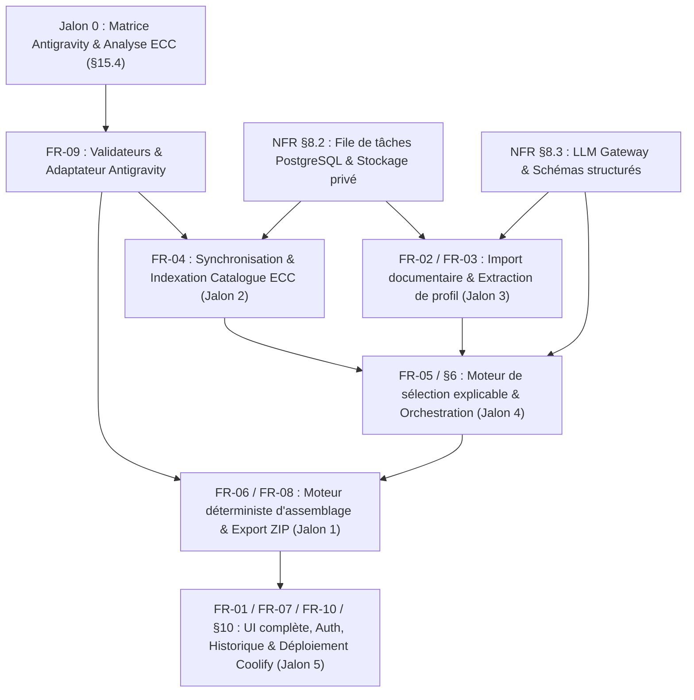

# Analyse du Cahier des Charges — Antigravity Harness Builder (Mission 0)

**Date d'analyse :** 29 octobre 2026  
**Source analysée :** [cahier_des_charges_antigravity_harness_builder.md](file:///root/webapp/AntigravityHarnessBuilder/cahier_des_charges_antigravity_harness_builder.md) (Version 1.2)  
**Statut :** Cadrage technique complet (Jalon 0 / Phase A) — Aucune implémentation applicative démarrée.

---

## 1. Synthèse de la vision et du périmètre produit

**Antigravity Harness Builder** est une application web privée conçue pour transformer les documents de cadrage d'un projet logiciel cible (au minimum un **cahier des charges** et un **design system**) en un **harnais de développement agentique sur mesure, minimal, cohérent et nativement exploitable par Google Antigravity** (App 2.0, IDE ou CLI `agy`).

Plutôt que de copier aveuglément l'intégralité de la bibliothèque open-source [Everything Claude Code (ECC)](https://github.com/affaan-m/ECC) (ce qui saturerait la fenêtre de contexte et introduirait des incompatibilités propres à Claude Code ou Codex), l'application agit comme un **compilateur de harnais** :
1. Elle extrait un **profil de projet structuré** en distinguant explicitement ce qui est certain (`source explicite`), interprété (`déduction` avec niveau de confiance), supposé (`hypothèse proposée`) ou lacunaire (`information manquante ou contradictoire`).
2. Elle interroge un **catalogue ECC synchronisé et versionné** (via commit SHA / tag Git) pour sélectionner uniquement les composants pertinents (règles, skills, sous-agents) et génère les composants spécifiques manquants.
3. Elle adapte chaque composant aux **conventions natives de Google Antigravity** (mapping des répertoires `.agents/`, traduction stricte des noms d'outils et des tiers de modèles, validation YAML, budget de tokens des règles).
4. Elle produit une **archive ZIP autonome et sécurisée** accompagnée d'un guide d'exécution prudent (`START_HERE.md`) et d'un manifeste machine-readable (`docs/HARNESS_MANIFEST.json`).

---

## 2. Inventaire exhaustif des exigences et traçabilité

Aucune exigence du cahier des charges n'a été supprimée, simplifiée ou réinterprétée. Le tableau ci-dessous recense l'ensemble des exigences fonctionnelles (FR) et non fonctionnelles (NFR), leur priorité et leurs critères d'acceptation associés.

### 2.1 Exigences fonctionnelles (FR-01 à FR-10 + Sections 3 à 6)

| ID | Intitulé & Exigences détaillées | Section CDC | Priorité | Critères de validation & d'acceptation (§11 & §15) |
| :--- | :--- | :--- | :--- | :--- |
| **FR-01** | **Gestion des projets de génération** Créer, nommer, consulter, dupliquer, archiver et supprimer un projet. Sélection de la surface Antigravity cible (`App`, `IDE`, `CLI`). Historisation de chaque génération avec statut (`en attente`, `en cours`, `terminée`, `partiellement échouée`, `échouée`). Séparation stricte entre le nom de l'application génératrice et le projet cible. | §3.1, §7 (FR-01) | **P0** | Isolation stricte par utilisateur (§11.4). Suppression en cascade documentée des fichiers et générations associés (§9, §11.4). |
| **FR-02** | **Import sécurisé et extraction documentaire** 2 entrées obligatoires : Cahier des charges + Design system. Formats V1 : `PDF`, `DOCX`, `Markdown`, `TXT`, `JSON`, `YAML`, `CSS/SCSS`, `PNG/JPEG`, et `SVG` (après validation sécurité). Notes complémentaires éditables (stack, déploiement, conformité, qualité, coûts, équipe). Contrôle du type MIME réel (magic bytes), taille, lisibilité, absence d'exécution de macros/code embarqué. Analyse visuelle sur images si le fournisseur LLM le supporte, sinon dégradation explicite. | §3.2, §7 (FR-02), §9 | **P0** | Rejet explicite des formats invalides, fichiers corrompus, vides ou malveillants (§11.1). Aucun profil vide généré silencieusement en cas d'erreur de parsing. |
| **FR-03** | **Profil de projet normalisé et traçable** Extraction typée et validée côté serveur : objectif, domaine, personas/rôles, fonctionnalités, règles métier, critères d'acceptation, stack, architecture/déploiement, sécurité/RGPD, tokens design system (typo, couleurs, espacements, composants, états, UX/UI), stratégie de tests. Classification obligatoire de chaque élément : `Source explicite`, `Déduction` (avec confiance), `Hypothèse proposée`, `Information manquante ou contradictoire`. Lien vers le document source. Édition par l'utilisateur avant sélection. | §3.3, §7 (FR-03), §15.1 (Jalon 3) | **P0** | Schéma Zod validé côté serveur. Interface d'édition fonctionnelle. Les hypothèses et manques sont préservés jusque dans `docs/ASSUMPTIONS.md` (§11.1). |
| **FR-04** | **Synchronisation et catalogue ECC versionné** Synchronisation depuis `https://github.com/affaan-m/ECC` sans scraping HTML fragile (via API GitHub / tarball Git). Enregistrement du SHA/tag, date, empreintes SHA-256 des fichiers, type, description, tags, chemins, licence, dépendances et compatibilité. Indexation pour la recherche. Résilience : une synchronisation échouée ou partielle ne remplace jamais le dernier catalogue valide. | §4.1, §4.2, §7 (FR-04), §15.1 (Jalon 2) | **P0** (Sync manuelle/CLI) / **P1** (Sync planifiée & UI admin) | Provenance traçable et SHA exact conservé dans chaque paquet (§11.2). Tolérance aux pannes GitHub et rate-limits vérifiée par tests. |
| **FR-05** | **Sélection explicable et moteur de recommandation** Recherche hybride (filtres métadonnées + recherche lexicale + recherche sémantique optionnelle si gain mesuré). Classement multicritère explicite (adéquation domaine, compatibilité surface/stack, utilité, clarté, risque sécurité, redondance, coût en contexte, maintenabilité). Affichage des raisons du choix et d'exclusion des candidats proches. Distinction entre composants ECC (tels quels ou adaptés) et composants générés sur mesure. Ajustement manuel par l'utilisateur (ajout/retrait/priorité, profils équilibré par défaut, minimal/approfondi en P1). | §3.4, §3.5, §4.3, §7 (FR-05), §15.1 (Jalon 4) | **P0** (Profil équilibré & édition) / **P1** (Variantes min/approfondie & comparateur) | Pas de copie intégrale d'ECC (§1.2, §11.2). Détection des doublons et dépendances manquantes avant export (§3.5). |
| **FR-06** | **Génération structurée et orchestration** Pipeline séquentiel : profil validé -> sélection -> plan de harnais -> rédaction des fichiers -> validation des liens/frontmatters -> assemblage -> contrôle final. Production de l'arborescence (`START_HERE.md`, `README.md`, `AGENTS.md`, `docs/*`, `.agents/rules/`, `.agents/skills/<name>/SKILL.md`, `.agents/agents/<name>.md`). Orchestration (§6) : décomposition atomique, gestion de concurrence, catalogue de rôles à privilèges minimaux, séparation stricte entre `model tier` (`inherit`, `flash`, `pro`), `effort` (`low`, `medium`, `high`) et recommandation coût/qualité. | §5, §6, §7 (FR-06), §15.3 | **P0** | Aucun appel LLM monolithique unique produisant tout le ZIP (§15.3). Séparation claire entre paramètre techniquement imposé (`model` dans le YAML subagent) et politique d'orchestration (`effort` dans `ORCHESTRATION.md`). |
| **FR-07** | **Prévisualisation avant export** Affichage de l'arborescence complète, lecture des fichiers générés, justifications des composants, hypothèses, avertissements de compatibilité, version/commit ECC, et résumé des contrôles passés/échoués. | §3.6, §7 (FR-07) | **P0** | L'utilisateur peut inspecter chaque fichier et activer/désactiver un composant avant de déclencher l'export final. |
| **FR-08** | **Export sécurisé (ZIP et `START_HERE.md`)** Génération d'une archive ZIP standard autonome + téléchargement séparé de `START_HERE.md` (en Markdown ou texte brut). Calcul et conservation de l'empreinte SHA-256 du paquet. Protection contre le Zip Slip (`..`, chemins absolus), les collisions, les répertoires vides et toute fuite de secrets ou fichiers système. | §1.1, §3.6, §5.1, §7 (FR-08), §9 | **P0** | ZIP décompressable par tout outil standard, conforme à `HARNESS_MANIFEST.json`, idempotent à l'installation via `START_HERE.md` (§5.1, §11.3, §11.4). |
| **FR-09** | **Contrôles de compatibilité et matrice Antigravity** Validation automatique des chemins natifs, du frontmatter YAML (règles, skills, sous-agents), de la présence de `SKILL.md`, des références croisées, de la liste blanche des outils Antigravity, du nommage des fichiers et de la cohérence du manifeste. Application des 3 niveaux de statut : `Validé automatiquement`, `Compatible selon documentation`, `Non vérifié`. | §4.4, §7 (FR-09), §15.4 | **P0** | Tout échec critique de compatibilité ou de sécurité bloque la génération (§15.2). Distinction explicite entre validation syntaxique, documentaire et d'exécution (§15.4). |
| **FR-10** | **Historique, traçabilité et auditabilité** Conservation par génération : documents d'entrée (empreintes), profil confirmé, version ECC, sélection, fichiers générés et rapport de validation. Absence totale de secrets ou de contenus confidentiels bruts dans les logs techniques. | §2.2, §7 (FR-10), §9 | **P0** | Traçabilité complète consultable depuis l'interface et vérifiable dans `HARNESS_MANIFEST.json` et `ECC_SOURCES.md`. |

### 2.2 Exigences non fonctionnelles (NFR — Sections 8, 9, 10, 14, 15)

| Catégorie | Exigences et contraintes | Section CDC |
| :--- | :--- | :--- |
| **Socle technique** | Next.js (App Router, dernière version stable), TypeScript strict (sans `any` injustifié), Tailwind CSS, PostgreSQL, Docker, Coolify sur VPS Ubuntu. Monolithe modulaire privilégié en V1. | §8.0, §8.1, §13.1 |
| **Sobriété architecturale** | Interdiction d'introduire Redis, un service Python séparé, des microservices ou une plateforme externe sans besoin mesuré et démontré. Un seul choix technologique par responsabilité, documenté par ADR. | §8.0, §8.2, §13 |
| **Traitements asynchrones** | Les tâches longues (sync ECC, extraction, génération, évaluation) ne doivent jamais dépendre du cycle de vie d'une requête HTTP. File de tâches persistante adossée à PostgreSQL avec états, retries bornés, timeouts, reprise après redémarrage, idempotence et suivi de progression. | §8.0, §8.2, §13.1 |
| **Fournisseur LLM & Coûts** | Passerelle serveur dédiée (`LLM Gateway`), clés strictement côté serveur, modèles configurables par variables d'environnement (Google Gemini initial), sorties structurées validées à l'exécution (Zod), cache par empreinte SHA-256 des entrées, relance d'une étape isolée sans tout recalculer. | §8.3, §15.3 |
| **Sécurité & Confidentialité** | Authentification et contrôle d'accès serveur systématique. Défense contre l'injection de prompt indirecte (documents importés et fichiers ECC traités comme données non fiables). Non-exécution absolue des scripts ECC ou macros documentaires. Sanitization SVG/ZIP/chemins. | §4.5, §9, §11.4 |
| **UX / UI & Accessibilité** | Design system propre à l'application génératrice (sobre, haut de gamme, distinct du design system importé). 8 écrans minimum. Navigation étape par étape réversible sans perte de saisie. Responsive (Desktop/Tablette, exploitable sur mobile) et accessible (clavier, contrastes, focus, ARIA). | §10 |
| **Qualité & Golden Dataset** | Jeu de tests de référence (« golden dataset ») couvrant 5 archétypes de projets (CRUD simple, SaaS multi-rôles, Design system riche, Sécurité forte, Documentaire incomplet/contradictoire). Tests unitaires, intégration et E2E critiques exécutables en CI. | §8.1, §11.5, §15.2 |

---

## 3. Dépendances entre exigences

L'analyse révèle un graphe de dépendances strict qui justifie pleinement l'ordre des jalons imposé par la section §15.1 du cahier des charges :

1. **Dépendance fondatrice (`Jalon 0 -> FR-09 -> FR-06/FR-04`) :** Il est impossible de construire le moteur d'export (Jalon 1) ou l'indexeur ECC (Jalon 2) sans avoir d'abord figé les règles exactes de validation d'Antigravity (noms d'outils autorisés, champs YAML de `SKILL.md`, `.agents/rules/*.md` et `.agents/agents/*.md`).
2. **Dépendance d'infrastructure asynchrone (`NFR §8.2 -> FR-04, FR-02, FR-06`) :** La synchronisation GitHub ECC, l'extraction PDF/DOCX/Vision et la génération multi-étapes dépassent le temps d'une requête HTTP standard et nécessitent que le système de jobs PostgreSQL soit opérationnel dès les Jalons 2 et 3.
3. **Dépendance de contrat de données (`FR-03 + FR-04 -> FR-05`) :** Le moteur de sélection explicable (Jalon 4) croise les attributs du `ProjectProfile` (Jalon 3) avec les métadonnées indexées des `EccComponent` (Jalon 2).

---

## 4. Ambiguïtés, tensions et contradictions identifiées

Conformément à la règle *« Pas d'invention silencieuse »* (§1.2) et aux consignes de la Mission 0 (§2.3, §2.4), voici les contradictions et ambiguïtés relevées entre le cahier des charges, le dépôt ECC réel et la documentation officielle d'Antigravity au **29 octobre 2026** :

### 4.1 Contradiction critique : Statut des `workflows/` entre ECC v2.2.3 et Antigravity (Octobre 2026)
- **Constat dans le cahier des charges (§4.4) :** Le CDC stipule à juste titre : *« Au moment de la rédaction de ce cahier des charges, la documentation officielle annonce l'arrêt du système de workflows actuel au 19 octobre 2026 ; privilégier les skills natifs et ne produire d'anciens fichiers workflow que si leur prise en charge actuelle est vérifiée. »*
- **Constat dans ECC v2.2.3 (`docs/ANTIGRAVITY-GUIDE.md` et `scripts/lib/install-targets/antigravity-project.js`) :** Vérification faite sur la branche `main` d'ECC (commit `25278e7d`), l'adaptateur Antigravity d'ECC continue de mapper le dossier `commands/` d'ECC vers `.agents/workflows/` en les présentant comme des workflows slash invocables.
- **Constat dans la documentation officielle Antigravity (au 29 octobre 2026) :** L'échéance du **19 octobre 2026 est désormais dépassée** (nous sommes le 29 octobre 2026). La documentation officielle d'Antigravity confirme que les workflows monolithiques `.agents/workflows/*.md` sont **dépréciés et désactivés** au profit des **Agent Skills** (`.agents/skills/<name>/SKILL.md`), avec un utilitaire de migration `/migrate-workflows`.
- **Résolution proposée (sans modifier l'exigence) :** Notre `Antigravity Adapter` ne doit **pas** imiter aveuglément `antigravity-project.js` d'ECC sur le point des workflows. Il doit exclure la génération de `.agents/workflows/*.md` par défaut et convertir toute commande/procédure ECC pertinente en **Skill natif** (`.agents/skills/<name>/SKILL.md`), ou la signaler comme obsolète dans le rapport de compatibilité.

### 4.2 Divergence sur les noms d'outils (`tools`) entre les surfaces Antigravity et l'adaptateur ECC
- **Constat :** Le script `scripts/lib/install/antigravity-agent.js` d'ECC v2.2.3 traduit les outils Claude Code (`Read`, `Write`, `Edit`, `Grep`, `Glob`, `Bash`, `WebSearch`, `WebFetch`) vers :
  `view_file`, `write_to_file`, `replace_file_content`, `grep_search`, `find_by_name`, `run_command`, `search_web`, `read_url_content`.
- **Nuance importante vérifiée dans l'environnement Antigravity actuel :**
  - Dans la documentation des **sous-agents Markdown** (`https://antigravity.google/docs/subagents`), les exemples officiels utilisent effectivement `view_file`, `write_to_file`, `replace_file_content`, `grep_search`, `find_by_name`, `run_command`, `search_web`, `read_url_content`.
  - En revanche, dans le **SDK Python Antigravity** (`BuiltinTools`) et dans le runtime **CLI (`agy` v1.4.9)**, certains outils internes portent des noms légèrement différents (`read_file`, `write_file`, `edit_file`, `create_file`, `list_directory`, `search_directory`, `find_file`), bien que le parseur de sous-agents de l'IDE/App mappe les alias documentés.
  - Plus grave : le script `antigravity-agent.js` d'ECC filtre silencieusement tout outil qui n'est pas dans ses 8 clés (`Object.hasOwn(TOOL_NAMES, name)`), ce qui supprime sans avertissement les outils MCP ou spécialisés.
- **Conséquence architecturale :** Notre validateur (FR-09) devra maintenir une table de correspondance explicite par surface (`App`, `IDE`, `CLI`) basée sur le schéma officiel des sous-agents Markdown d'Antigravity, et émettre un **avertissement explicite** lorsqu'un outil ECC (ex: un outil MCP `mcp__...` ou `Task`) est retiré ou nécessite l'enregistrement d'un serveur MCP dans le parent.

### 4.3 Tension sur la configuration du niveau d'effort (`effort` / `thinking_level`)
- **Constat (§6.3 du CDC) :** Le CDC demande de séparer le *tier de modèle* (`inherit`, `flash`, `pro`), le *niveau d'effort de raisonnement* (`low`, `medium`, `high`, `max`) et la *recommandation qualité/coût*, tout en précisant : *« Si l'effort ne peut pas être assigné indépendamment à chaque tâche ou sous-agent par un fichier de configuration, l'enregistrer comme politique d'orchestration et recommandation, et non comme paramètre techniquement imposé. »*
- **Vérification documentaire :** Le schéma YAML officiel des sous-agents Antigravity (`.agents/agents/<name>.md`) supporte le champ `model` (`inherit`, `flash`, `pro`), mais **ne supporte pas de champ `effort` ou `thinking_level` dans le frontmatter YAML du sous-agent** (l'effort se règle au niveau de la session dans le sélecteur de modèle de l'UI Antigravity 2.0 / IDE, ou via `--effort` / `/effort` dans la CLI `agy`).
- **Résolution :** Conformément à la règle de prudence du §6.3, le champ `model` sera écrit dans le YAML du sous-agent (`Configurable / Validé automatiquement`), tandis que le niveau d'effort sera consigné dans `docs/ORCHESTRATION.md` et `docs/HARNESS_MANIFEST.json` avec le statut `Seulement indicatif (politique d'orchestration / réglage de session)`.

### 4.4 Ambiguïtés fonctionnelles nécessitant un arbitrage (renvoyées vers `docs/OPEN_QUESTIONS.md`)
1. **Modèle d'authentification et multi-utilisateurs (§9, §10, §12) :** L'application est qualifiée d'« application web privée » (§1) mais exige une authentification, une isolation stricte entre utilisateurs (§11.4) et un écran d'administration ECC (§10). Le mode d'inscription (comptes pré-provisionnés par admin, invitation par e-mail, OAuth GitHub/Google ou identifiants locaux email/mot de passe) n'est pas spécifié.
2. **Exécution de l'application sur le VPS actuel :** L'inspection du VPS révèle que **Coolify v4.5.3**, **Docker** et **PostgreSQL (15, 17, 18)** tournent déjà, mais que **Node.js n'est pas installé directement sur l'hôte Ubuntu** (uniquement dans des conteneurs Docker). Le développement et les tests devront donc s'exécuter dans un conteneur de développement ou après installation contrôlée d'une version LTS de Node.js.
3. **Inclusion des Hooks et Serveurs MCP dans la V1 (§4.4 vs `harness-capabilities.js` d'ECC) :** Dans ECC v2.2.3, l'adaptateur Antigravity déclare explicitement `hooks: not-configured` car les scripts de hooks d'ECC ciblent le contrat JSON de Claude Code (qui diffère du contrat `hooks.json` camelCase/protojson d'Antigravity sur les clés comme `injectSteps` ou `permissionOverrides`). Faut-il exclure totalement les hooks exécutables ECC en V1 au profit des règles et skills, ou construire un traducteur de hooks ?

---

## 5. Hypothèses techniques vérifiées vs non vérifiées

| Hypothèse initiale | Statut après vérification (Mission 0) | Preuve / Source (29 oct. 2026) |
| :--- | :--- | :--- |
| Le dépôt `affaan-m/ECC` est accessible publiquement et sous licence permissive. | **Confirmé (Test réel + Doc)** | Dépôt GitHub actif (v2.2.3, commit `25278e7d` du 26 oct. 2026), licence **MIT** (`Copyright (c) 2026 Affaan Mustafa`). |
| ECC possède une structure de catalogue machine-readable exploitable sans scraping HTML. | **Confirmé (Test réel)** | Présence de `manifests/install-components.json`, `manifests/install-modules.json`, `manifests/install-profiles.json`, et de YAML frontmatters standardisés dans `agents/*.md` et `skills/*/SKILL.md`. |
| Antigravity 2.0 utilise `.agents/` (au pluriel) comme répertoire canonique de projet. | **Confirmé (Doc officielle + Builtin Skills)** | Confirmé par `agy-customizations/SKILL.md` et `ECC/docs/ANTIGRAVITY-GUIDE.md` (`.agent/` au singulier est un alias legacy). |
| Les règles Antigravity ont une limite de taille de fichier et de budget de contexte. | **Confirmé (Doc interne Antigravity)** | Limite stricte de **24 Ko (24 000 octets)** par fichier de règle et budget global de **20 000 tokens** pour les règles `always_on` (`agy-customizations/docs/rules.md`). Point crucial pour le `Harness Builder` ! |
| Les workflows `.agents/workflows/*.md` sont toujours le mécanisme principal d'Antigravity. | **Infirmé (Obsolète depuis le 19 oct. 2026)** | Dépréciés et arrêtés le 19 octobre 2026 au profit de `.agents/skills/<name>/SKILL.md` (§4.4 du CDC confirmé par la doc officielle). |
| Le niveau d'effort (`low`, `medium`, `high`) peut être fixé par fichier YAML de sous-agent. | **Infirmé (Configuration de session uniquement)** | Seul `model: inherit | flash | pro` existe dans le frontmatter YAML des sous-agents. L'effort se configure en session (UI ou CLI `--effort`). |
| Le VPS hôte dispose des ressources suffisantes pour un monolithe Next.js + PostgreSQL. | **Confirmé (Test réel)** | VPS Linux x86_64 avec 7,8 Go de RAM (5,8 Go disponibles), 96 Go de disque SSD (87 Go libres, 10% utilisés), Docker et Coolify 4.5.3 actifs. |

---

## 6. Analyse approfondie des risques et mesures de prévention

Conformément à la section 5 de la Mission 0, les 8 risques majeurs ont été analysés avec des mesures de prévention architecturales et des critères de validation mesurables :

### Risque R-01 — Génération de configurations incompatibles avec Antigravity
- **Causes possibles :** Hallucination par le LLM de clés YAML inexistantes, d'outils Claude Code (`Read`, `Bash`, `Task`), de noms de modèles obsolètes (`claude-3-opus`, `gemini-1.5-pro`), dépassement de la limite de 24 Ko par fichier de règle, ou utilisation de variables spécifiques à Claude (`${CLAUDE_PLUGIN_ROOT}`).
- **Mesures de prévention :**
  1. **Séparation rédaction / assemblage :** Le LLM ne génère jamais directement le frontmatter YAML libre. Il produit un objet JSON validé par Zod ; un sérialiseur déterministe (testé au Jalon 1) génère le frontmatter YAML.
  2. **Liste blanche stricte (`Antigravity Adapter`) :** Validation statique des clés de frontmatter, des valeurs de `model` (`inherit | flash | pro`), des `trigger` de règles (`always_on | model_decision | glob | manual`), et rejet de tout outil hors liste blanche Antigravity.
  3. **Scanner d'incompatibilité croisée :** Détection par regex des variables `${CLAUDE_*}`, `$ARGUMENTS`, et vérification que chaque règle pèse `< 24 000` octets et que la somme des règles `always_on` + `AGENTS.md` respecte un budget conservateur (`< 15 000` tokens estimés, sous le plafond de 20 000 tokens).
- **Critère de validation mesurable :** **100 %** des fichiers générés sur le Golden Dataset passent le validateur statique `AntigravityValidator` avec `0` erreur de schéma, `0` outil inconnu et `0` dépassement du quota de 24 Ko par règle.

### Risque R-02 — Instructions malveillantes (Prompt Injection) dans les documents importés ou ECC
- **Causes possibles :** Un cahier des charges PDF/DOCX ou un composant tiers contient des instructions cachées (texte blanc sur blanc, caractères Unicode invisibles/zero-width, homoglyphes, balises système simulées) ordonnant au LLM d'ignorer ses règles, d'exfiltrer des clés d'API ou d'insérer une porte dérobée dans `START_HERE.md` ou `.agents/rules/`.
- **Mesures de prévention :**
  1. **Sanitization pré-LLM :** Nettoyage systématique des caractères Unicode invisibles/bidi (`U+200B` à `U+200F`, `U+202A` à `U+202E`, `U+FEFF`), normalisation NFC et détection des motifs d'injection connus.
  2. **Isolation structurelle des prompts (Data vs Instructions) :** Les textes extraits des documents et d'ECC sont encapsulés dans des balises XML délimitées avec instruction système explicite de les traiter exclusivement comme des données passives non fiables.
  3. **Sorties structurées contraintes :** L'étape d'analyse documentaire ne produit pas directement de fichiers Markdown exécutables par un agent, mais un `ProjectProfile` JSON fortement typé et borné.
  4. **Inspection post-génération :** Analyse lexicale des fichiers générés (`AGENTS.md`, `START_HERE.md`, règles, skills) pour bloquer toute URL externe non présente dans les sources officielles, toute commande `curl | sh`, `eval`, ou lecture de fichiers sensibles (`~/.ssh`, `.env`, `~/.gemini`).
- **Critère de validation mesurable :** **100 %** des cas de test d'injection (payloads d'exfiltration et d'override système inclus dans le Golden Dataset sécurité) sont neutralisés ou bloqués avant export.

### Risque R-03 — Exécution non contrôlée de scripts externes
- **Causes possibles :** Exécution de macros DOCX/PDF lors du parsing serveur, exécution des scripts Node/Bash d'installation d'ECC (`install.sh`, `doctor.js`, `hooks/*.sh`) sur le serveur de l'application, ou exécution aveugle par l'agent Antigravity de l'utilisateur lors de l'installation du paquet.
- **Mesures de prévention :**
  1. **Côté serveur (Application Web) :** Synchronisation d'ECC uniquement par lecture passive des fichiers (API GitHub Trees/Blobs ou extraction d'archive tarball en mémoire/stockage isolé sans jamais invoquer `node`, `sh` ou `npm` sur le contenu ECC). Parsing documentaire via des bibliothèques purement déclaratives sans support de macros ni d'entités XML externes (XXE désactivé).
  2. **Dans le paquet généré :** Par défaut, aucun script exécutable (`.sh`, `.js`, `.py`) ni fichier `hooks.json` n'est inclus. Si un skill nécessite un script helper dans `scripts/`, celui-ci est désactivé par défaut (sans bit d'exécution `+x` dans le ZIP), signalé par un avertissement de sécurité dans l'UI et le manifeste, et `START_HERE.md` impose une revue et confirmation humaine explicite avant toute exécution (§5.1 point 9).
- **Critère de validation mesurable :** **0** appel système (`child_process.exec`/`spawn`) sur des fichiers provenant des utilisateurs ou d'ECC dans le code de l'application (vérifié par règle ESLint/AST).

### Risque R-04 — Générations incohérentes ou non reproductibles
- **Causes possibles :** Variabilité stochastique du LLM, changement silencieux de la branche `main` d'ECC entre deux générations, ou contradictions entre `AGENTS.md`, `ORCHESTRATION.md` et les sous-agents générés.
- **Mesures de prévention :**
  1. **Verrouillage par SHA (Pinning) :** Chaque génération est liée de manière immuable à un `eccSyncId` (identifié par le SHA exact du commit Git d'ECC) et aux empreintes SHA-256 des documents sources et du `ProjectProfile` confirmé.
  2. **Moteur d'assemblage déterministe (Jalon 1) :** À profil confirmé, sélection de composants et contenus adaptés identiques, le `Package Exporter` produit un arbre de fichiers et un manifeste strictement déterministes (température `0` ou `low` sur les appels structurés, tri canonique des clés JSON et des entrées ZIP).
  3. **Contrôleur de cohérence inter-fichiers (FR-09) :** Vérifie que chaque sous-agent mentionné dans `ORCHESTRATION.md` existe dans `.agents/agents/`, que chaque skill référencé possède son `.agents/skills/<name>/SKILL.md`, et que `HARNESS_MANIFEST.json` reflète exactement le contenu du ZIP.
- **Critère de validation mesurable :** Deux exécutions du moteur d'assemblage (Jalon 1) avec les mêmes entrées produisent exactement la même structure et les mêmes hash SHA-256 de fichiers (hors horodatage de génération isolé dans le manifeste).

### Risque R-05 — Perte de progression lors d'un traitement long
- **Causes possibles :** Expiration du timeout HTTP (proxy Traefik/Coolify à 60s), fermeture de l'onglet par l'utilisateur, crash ou redémarrage du conteneur Docker pendant une analyse PDF/Vision ou une génération multi-fichiers.
- **Mesures de prévention :**
  1. **Découplage HTTP / Exécution :** Les requêtes HTTP mutatives créent un enregistrement `Job` en base PostgreSQL et retournent immédiatement un `202 Accepted` avec l'identifiant du job.
  2. **Machine à états persistante par étape (Checkpointing) :** Le pipeline est découpé en étapes atomiques sauvegardées en base (`DOCUMENT_EXTRACTION`, `PROFILE_SYNTHESIS`, `ECC_SELECTION`, `ARTIFACT_GENERATION`, `PACKAGE_VALIDATION`, `ZIP_EXPORT`). Si une étape échoue, seules les sous-étapes non complétées sont relancées (idempotence et cache par hash d'entrée §15.3).
  3. **Récupération des jobs bloqués (Stale Job Recovery) :** Mécanisme de `heartbeat` et de verrouillage transactionnel (`SELECT ... FOR UPDATE SKIP LOCKED`) permettant de reprendre proprement un job interrompu par un redémarrage de conteneur, avec un plafond strict de tentatives (`maxAttempts = 3`).
- **Critère de validation mesurable :** Un redémarrage du conteneur ou un rafraîchissement du navigateur en cours de génération ne fait perdre aucune donnée validée et permet la reprise à la dernière étape persistée.

### Risque R-06 — Dépendance excessive à un fournisseur de modèles d'IA
- **Causes possibles :** Couplage du code métier (extraction de profil, sélection, génération) aux types spécifiques du SDK `@google/genai`, indisponibilité régionale d'une API ou dépréciation d'un identifiant de modèle.
- **Mesures de prévention :**
  1. **Pattern Port & Adapter (`LLMGateway`) :** Toute interaction avec un LLM passe par une interface TypeScript interne agnostique (`generateStructured<T>(request, zodSchema)`, `analyzeVisualDocument(...)`).
  2. **Configuration externe :** Les identifiants de modèles (`LLM_MODEL_FAST`, `LLM_MODEL_REASONING`, `LLM_MODEL_VISION`) et le fournisseur actif (`LLM_PROVIDER=gemini`) sont injectés par variables d'environnement sans aucun nom de modèle codé en dur dans la logique métier.
  3. **Dégradation élégante :** Les jalons 1 (assemblage/validation ZIP) et 2 (synchronisation et filtrage déterministe du catalogue ECC) fonctionnent à **100 % sans LLM**.
- **Critère de validation mesurable :** Le remplacement de l'adaptateur Gemini par un `MockLLMAdapter` (pour les tests CI) ou un adaptateur OpenAI/Anthropic alternatif s'effectue en modifiant un seul fichier d'adaptateur et les variables d'environnement, avec `0` modification dans les domaines métier.

### Risque R-07 — Coûts imprévisibles des appels aux modèles
- **Causes possibles :** Boucles de relance infinies en cas d'erreur de validation Zod, envoi répété de documents volumineux, utilisation systématique d'un modèle coûteux (`Pro`) pour des tâches simples, ou abus par rafraîchissement intensif de l'interface.
- **Mesures de prévention :**
  1. **Cache de contenu adressable par SHA-256 :** Si l'empreinte SHA-256 d'un document importé ou d'un couple `(profil_hash, selection_hash, ecc_commit_sha)` a déjà été traitée, le résultat validé en base est réutilisé sans appel LLM (§15.3).
  2. **Routage par tier de modèle :** Utilisation d'un modèle rapide/économique (`Flash`) pour l'extraction structurée initiale et le pré-classement, et d'un modèle avancé (`Pro`) uniquement pour l'arbitrage architectural complexe si nécessaire.
  3. **Quotas et coupe-circuits (Circuit Breakers) :** Plafond strict de tokens par requête (`maxOutputTokens`), budget maximum d'appels LLM et de tokens cumulés par génération (`MAX_TOKENS_PER_GENERATION` configurable), `maxRetries = 2` sur échec de schéma, et rate-limiting par utilisateur sur les routes de génération et de synchronisation.
  4. **Comptabilité transparente :** Enregistrement systématique des tokens consommés (`inputTokens`, `outputTokens`, `thinkingTokens`, coût estimé) dans la table `Job` / `HarnessGeneration`.
- **Critère de validation mesurable :** Toute génération dépassant le plafond configuré (`MAX_LLM_CALLS_PER_JOB` ou `MAX_TOKENS_PER_JOB`) est interrompue proprement avec un statut explicite et un message utilisateur clair.

### Risque R-08 — Gestion incorrecte des versions, licences et provenances des composants ECC
- **Causes possibles :** Oubli de la mention de licence MIT et du copyright dans le paquet généré, impossibilité de savoir de quel commit ECC provient un skill après mise à jour du catalogue, ou confusion entre un fichier officiel ECC, un fichier modifié et un fichier généré de toutes pièces.
- **Mesures de prévention :**
  1. **Versionnage immuable des snapshots ECC :** La table `EccSync` conserve l'historique des synchronisations (SHA du commit, tag, date, licence détectée). Les composants liés à une génération existante restent rattachés à leur version source.
  2. **Qualification tripartite obligatoire (§4.5) :** Chaque artefact du paquet est marqué dans `HARNESS_MANIFEST.json` et `docs/ECC_SOURCES.md` avec son statut exact : `ecc_verbatim` (utilisé tel quel), `ecc_adapted` (adapté pour Antigravity et le projet, avec liste des transformations appliquées) ou `project_custom` (créé spécifiquement pour le projet).
  3. **Inclusion automatique des licences :** Génération systématique de `docs/ECC_SOURCES.md` contenant le texte de la licence MIT d'ECC, l'attribution à l'auteur (`Affaan Mustafa`), le SHA du commit source et l'URL GitHub exacte (`https://github.com/affaan-m/ECC/blob/<commit-sha>/<path>`) pour chaque composant retenu.
- **Critère de validation mesurable :** **100 %** des composants externes présents dans le ZIP possèdent une entrée valide avec `sourceCommitSha`, `sourceUrl`, `license: "MIT"` et `adaptationStatus` dans `HARNESS_MANIFEST.json` et `docs/ECC_SOURCES.md`.
