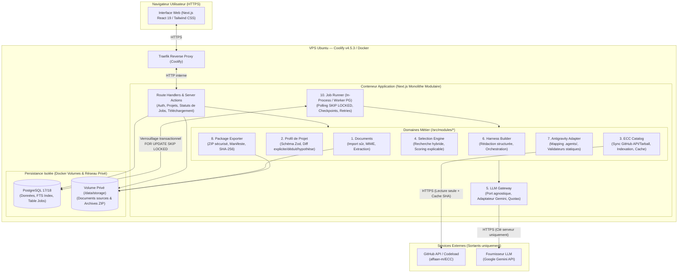
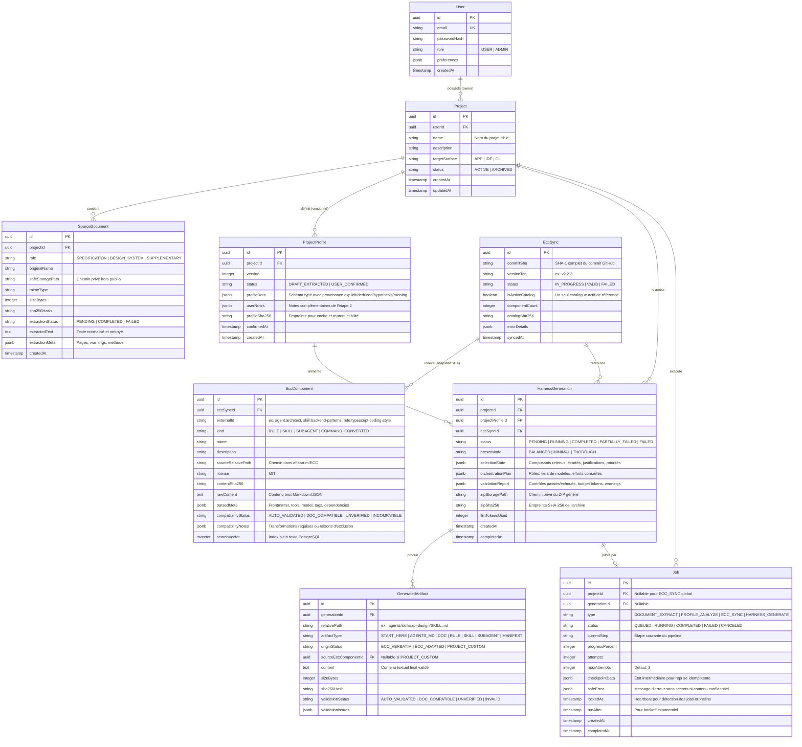
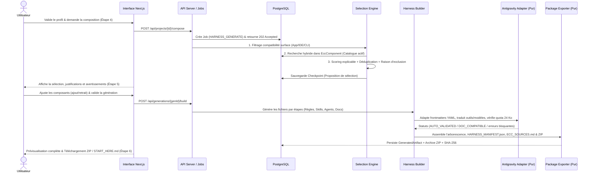

# Proposition d'Architecture — Antigravity Harness Builder

**Date :** 29 octobre 2026  
**Style d'architecture :** Monolithe modulaire (Next.js App Router + PostgreSQL + Stockage privé sur volume persistant + Worker asynchrone adossé à PostgreSQL).  
**Environnement cible :** VPS Ubuntu (7,8 Go RAM, 96 Go SSD), Docker & Coolify v4.5.3.

---

## 1. Principes directeurs et philosophie d'architecture

Conformément aux sections §8.0 et §13 du cahier des charges, l'architecture proposée respecte trois règles d'or :

1. **Sobriété opérationnelle maximale (Zéro infrastructure superflue) :**
   - **Pas de Redis**, pas de broker externe (RabbitMQ/Kafka), pas de microservice Python séparé, pas de base vectorielle externe en V1.
   - **PostgreSQL 17/18** est la source de vérité unique pour les données relationnelles, la recherche plein texte (`tsvector` + `pg_trgm`), les structures flexibles (`JSONB` validé par Zod) et la file de tâches persistantes (`Job`).
2. **Séparation stricte du cœur déterministe et de l'IA générative :**
   - Le moteur d'adaptation Antigravity (`Antigravity Adapter`), le validateur de compatibilité et l'assembleur d'archive (`Package Exporter`) sont des **fonctions pures et déterministes**, testables à 100 % sans aucun appel LLM (conformément au Jalon 1).
   - Le LLM (`LLM Gateway`) n'intervient que sur des étapes cognitives bornées (extraction de profil, enrichissement du classement, rédaction assistée de sections) en produisant exclusivement des **sorties structurées validées par Zod**.
3. **Découplage total entre requêtes HTTP et traitements longs :**
   - Aucune opération lourde (synchronisation GitHub ECC, extraction multi-documents, génération du harnais) ne s'exécute de manière bloquante dans le cycle de vie d'une requête HTTP Next.js.

---

## 2. Vue d'ensemble du système (Diagramme de conteneurs & composants)

---

## 3. Découpage en 10 modules métier et frontières de responsabilité (§13 CDC)

L'arborescence du code dans `src/modules/` isole strictement les 10 domaines exigés par la section 13 du cahier des charges. Les dépendances inter-modules sont unidirectionnelles (aucune dépendance circulaire) :

| # | Module (`src/modules/<nom>`) | Responsabilités exclusives | Dépendances autorisées | Garanties de sécurité & qualité |
| :--- | :--- | :--- | :--- | :--- |
| **1** | **`documents`** | Vérification des magic bytes/MIME, contrôle de taille, calcul SHA-256, stockage dans le volume privé hors `public/`, extraction de texte brut/structuré (`PDF`, `DOCX`, `MD`, `TXT`, `JSON`, `YAML`, `CSS/SCSS`), sanitization SVG, nettoyage Unicode anti-injection. | Stockage privé, `llm-gateway` (uniquement pour l'analyse visuelle PNG/JPEG si activée). | N'exécute jamais de macro, de JS ni d'entités externes XML (XXE). |
| **2** | **`project-profile`** | Définition du schéma strict `ProjectProfileSchema` (Zod), structuration des champs extraits avec qualification (`explicit`, `deduced`, `hypothesis`, `missing_or_contradictory`), niveau de confiance et citation de source (`documentId`, extrait/page). Gestion des éditions manuelles de l'utilisateur. | `documents`, `llm-gateway`, Base de données. | Sépare la version extraite par l'IA de la version confirmée/corrigée par l'humain. |
| **3** | **`ecc-catalog`** | Synchronisation atomique depuis `https://github.com/affaan-m/ECC` (via tarball GitHub d'un commit/tag identifiable), parsing des manifestes (`manifests/*.json`), des `rules/`, `agents/` et `skills/*/SKILL.md`. Exclusion de `.agents/` (Codex) et `hooks/`. Indexation plein texte PostgreSQL. | API GitHub, `antigravity-adapter`, Base de données. | Transaction atomique : si la synchronisation échoue, le catalogue précédent reste intact (FR-04). |
| **4** | **`selection-engine`** | Filtrage bloquant de compatibilité Antigravity, recherche hybride (métadonnées + lexicale FTS PostgreSQL), classement multicritère explicable (pertinence métier/stack, coût contexte, sécurité, redondance), détection des dépendances et proposition de composants sur mesure (`project_custom`). | `project-profile`, `ecc-catalog`, `antigravity-adapter`, `llm-gateway`. | Explique chaque choix ET pourquoi les candidats proches ont été écartés (§15.1 Jalon 4). |
| **5** | **`llm-gateway`** | Interface abstraite `LLMProvider`, implémentation initiale Google Gemini (`@google/genai`), validation systématique des sorties par schéma Zod, cache par hash SHA-256 des entrées, gestion des timeouts, retries bornés, rate-limiting et comptabilité des tokens/coûts. | SDK Fournisseur IA, Base de données (cache & métriques). | Aucune clé API exposée côté client ou dans les logs. Coupe-circuit budgétaire par job. |
| **6** | **`harness-builder`** | Pipeline séquentiel de génération : construction du plan d'orchestration (`ORCHESTRATION.md`), adaptation des composants ECC retenus, génération des composants sur mesure, de `AGENTS.md`, `START_HERE.md`, `README.md` et des documents normalisés (`docs/*.md`). | `project-profile`, `selection-engine`, `antigravity-adapter`, `llm-gateway`. | Pipeline par étapes avec checkpoints ; pas d'appel LLM unique monolithique (§15.3). |
| **7** | **`antigravity-adapter`** | **Cœur déterministe sans LLM :** constantes et schémas par surface (`App`, `IDE`, `CLI`), table de traduction des outils Claude -> Antigravity, mapping des tiers de modèles (`inherit`, `flash`, `pro`), sérialisation YAML canonique, validateurs syntaxiques et de budget de tokens (`< 24 Ko` par règle, `< 20 000` tokens cumulés). | *Aucune dépendance externe ni LLM* (module pur). | Bloque toute configuration invalide ou non vérifiée. Maintient la matrice de compatibilité (§15.4). |
| **8** | **`package-exporter`** | **Cœur déterministe sans LLM :** assemblage en mémoire/streaming de l'archive ZIP, génération de `docs/HARNESS_MANIFEST.json` et `docs/ECC_SOURCES.md` (licence MIT + URLs par commit SHA), calcul des empreintes SHA-256, protection anti-Zip Slip et anti-collision. | `antigravity-adapter`, Stockage privé. | Reproductibilité bit-à-bit (hors timestamp manifeste) à entrées identiques (Jalon 1). |
| **9** | **`ui-projects`** | Composants React/Tailwind du design system propre à l'application, gestion des projets (FR-01), assistant en 6 étapes (§3), éditeur de profil, ajustement de sélection, explorateur d'arborescence et prévisualiseur de fichiers avec avertissements. | Tous les modules via couche service serveur + Authentification. | Contrôle d'autorisation serveur systématique (`userId`) sur chaque route et action (§9). |
| **10** | **`jobs-observability`** | File d'attente persistante adossée à PostgreSQL (`SELECT ... FOR UPDATE SKIP LOCKED`), exécution asynchrone par étapes, suivi de progression en temps réel (polling léger ou SSE), reprise après redémarrage, journalisation structurée JSON (Pino) expurgée de toute donnée confidentielle. | Base de données PostgreSQL. | Compatible avec un conteneur unique ou un worker séparé sous Coolify sans changer le code métier. |

---

## 4. Modèle de données relationnel (PostgreSQL)

Le schéma suivant concrétise et précise les entités de la section §12 du cahier des charges :

---

## 5. Flux de données principaux et exécution asynchrone

### 5.1 Flux d'analyse documentaire et de confirmation du profil (Étapes 2 & 3)
1. **Import (`POST /api/projects/[id]/documents`) :**
   - Vérification de la session utilisateur et de la propriété du projet (`project.userId === session.user.id`).
   - Validation des magic bytes (ex: `%PDF-`, signature ZIP/DOCX `PK\x03\x04`, UTF-8 valide pour MD/TXT/JSON/YAML/CSS, DOMPurify/liste blanche stricte sans `<script>` ni `on*` pour SVG).
   - Écriture dans `/data/storage/projects/<projectId>/inputs/<uuid>` et création de `SourceDocument`.
2. **Job d'extraction et d'analyse (`DOCUMENT_EXTRACT` -> `PROFILE_ANALYZE`) :**
   - Extraction déterministe du texte et de la structure (titres, tableaux, tokens CSS/JSON).
   - Nettoyage anti-injection (suppression des caractères Unicode de contrôle/invisibles).
   - Appel au `LLM Gateway` avec `ProjectProfileSchema` (Zod) : chaque exigence, règle métier ou token de design system extrait est obligatoirement accompagné de `{ classification: 'explicit' | 'deduced' | 'hypothesis' | 'missing_or_contradictory', confidence: 'high' | 'medium' | 'low', sourceRef: '...' }`.
3. **Validation humaine :**
   - L'utilisateur consulte, filtre par statut (`explicit`, `deduced`, `hypothesis`, `missing`) et modifie le profil dans l'interface. La validation crée une version figée `USER_CONFIRMED` avec son `profileSha256`.

### 5.2 Flux de sélection explicable et de génération du harnais (Étapes 4, 5 & 6)

---

## 6. Architecture de déploiement sous Docker & Coolify (VPS Ubuntu)

Conformément à l'inspection du VPS (Coolify v4.5.3 actif, 7,8 Go RAM, 87 Go SSD disponibles), le déploiement en production reposera sur une architecture conteneurisée simple et robuste :

1. **Image Docker multi-stage (`Dockerfile`) :**
   - `deps` : installation reproductible via `npm ci` (fichier `package-lock.json` verrouillé).
   - `builder` : vérification du typage (`tsc --noEmit`) et build Next.js en mode `output: 'standalone'`.
   - `runner` : image `node:22-alpine` (ou `debian-slim` si requis par un parseur natif), utilisateur non-root (`nextjs:nodejs`), sans aucun secret intégré à l'image (§8.4).
2. **Exécution du Worker de Jobs :**
   - Le code du `JobRunner` est partagé au sein du monolithe.
   - En V1 sur le VPS, il peut tourner soit dans une boucle asynchrone singleton initialisée par `instrumentation.ts` de Next.js (zéro conteneur supplémentaire), soit via une seconde commande du même conteneur Docker (`node dist/worker.js`) dans le `docker-compose.yml` géré par Coolify, garantissant qu'aucun traitement n'impacte la latence du serveur HTTP tout en partageant exactement la même base de code.
3. **Volumes persistants et sauvegardes :**
   - `pg_data` : données PostgreSQL 17/18.
   - `app_storage` : monté sur `/data/storage` (droits `0700`, accessible uniquement par l'utilisateur applicatif) pour les documents importés et les ZIP générés.
   - Script documenté de sauvegarde (`pg_dump` + archive chiffrée/compressée de `/data/storage`) et de restauration testée (§8.4, §11.5).
4. **Endpoint de santé (`/api/health`) :**
   - Vérifie la connectivité PostgreSQL (`SELECT 1`), l'accès en écriture au volume privé `/data/storage`, et l'état du dernier catalogue ECC, utilisé par le healthcheck Docker/Coolify pour le déploiement zero-downtime et le rollback automatique.
