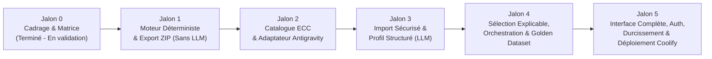

# Plan d'Implémentation par Jalons — Antigravity Harness Builder

**Date :** 29 octobre 2026  
**Référence :** Sections §14, §15.1, §15.2 et §16 du Cahier des charges.

Conformément à l'exigence prioritaire §15.1 du cahier des charges, **il est interdit de développer l'application en une seule passe ou de privilégier l'interface sur la fiabilité du moteur de génération**. Chaque jalon ci-dessous possède des livrables précis, des dépendances explicites et des critères de sortie vérifiables par des tests réellement exécutés.

---

## Vue synoptique des jalons et phases

---

## Jalon 0 — Vérification des hypothèses techniques et cadrage (Mission 0)

- **Statut :** **Réalisé et validé par l'utilisateur le 29 octobre 2026.**
- **Contenu livré :**
  1. [docs/ANALYSIS.md](file:///root/webapp/AntigravityHarnessBuilder/docs/ANALYSIS.md) — Analyse intégrale du cahier des charges, inventaire des exigences, contradictions identifiées et matrice des risques R-01 à R-08.
  2. [docs/COMPATIBILITY_MATRIX.md](file:///root/webapp/AntigravityHarnessBuilder/docs/COMPATIBILITY_MATRIX.md) — Matrice datée (29/10/2026) des capacités Antigravity (App, IDE, CLI) et d'ECC v2.2.3 (commit `25278e7d`).
  3. [docs/ARCHITECTURE_PROPOSAL.md](file:///root/webapp/AntigravityHarnessBuilder/docs/ARCHITECTURE_PROPOSAL.md) — Architecture en monolithe modulaire (10 domaines), modèle de données PostgreSQL et flux asynchrones.
  4. [docs/TECHNICAL_DECISIONS.md](file:///root/webapp/AntigravityHarnessBuilder/docs/TECHNICAL_DECISIONS.md) — 9 ADR couvrant la stack, Drizzle, la file de jobs PostgreSQL, la passerelle LLM, la synchronisation ECC par tarball, le stockage et les tests.
  5. [docs/IMPLEMENTATION_PLAN.md](file:///root/webapp/AntigravityHarnessBuilder/docs/IMPLEMENTATION_PLAN.md) — Présent plan de livraison par jalons.
  6. [docs/OPEN_QUESTIONS.md](file:///root/webapp/AntigravityHarnessBuilder/docs/OPEN_QUESTIONS.md) — Questions ouvertes classées par criticité (arbitrées le 29/10/2026).
- **Critère de sortie :** Validé le 29 octobre 2026.

---

## Jalon 1 — Socle technique & Moteur déterministe de paquet (100 % sans LLM)

- **Statut :** **Terminé et validé par tests le 29 octobre 2026.**
- **Objectif (§15.1) :** Initialiser le socle TypeScript strict et construire le cœur déterministe (`antigravity-adapter` + `package-exporter`) qui prend un profil de projet structuré et une sélection de composants connue en entrée, valide tous les formats/chemins/frontmatters/budgets et génère un paquet ZIP autonome et reproductible **sans aucun appel à un fournisseur d'IA**.
- **Prérequis :** Validation du Jalon 0 + exécution conteneurisée Docker (`node:22-alpine` — Option B validée).
- **Livrables techniques réalisés :**
  1. Initialisation du projet Next.js (App Router, TypeScript `strict: true`, Vitest, [Dockerfile](file:///root/webapp/AntigravityHarnessBuilder/Dockerfile) multi-stage, [.env.example](file:///root/webapp/AntigravityHarnessBuilder/.env.example)).
  2. Schémas Zod fondamentaux ([src/modules/project-profile/schema.ts](file:///root/webapp/AntigravityHarnessBuilder/src/modules/project-profile/schema.ts), [src/modules/antigravity-adapter/schema.ts](file:///root/webapp/AntigravityHarnessBuilder/src/modules/antigravity-adapter/schema.ts), [src/modules/package-exporter/schema.ts](file:///root/webapp/AntigravityHarnessBuilder/src/modules/package-exporter/schema.ts)).
  3. Module `src/modules/antigravity-adapter/` :
     - Traducteur déterministe des outils Claude -> Antigravity (`view_file`, `write_to_file`, `replace_file_content`, `grep_search`, `find_by_name`, `run_command`, `search_web`, `read_url_content`).
     - Traducteur des tiers de modèles (`inherit`, `flash`, `pro`) et séparation de la recommandation d'effort (`low`, `medium`, `high`).
     - Suite des 5 validateurs statiques (`PathSafetyValidator`, `RuleValidator` avec quota 24 Ko / 20k tokens, `SkillValidator`, `SubagentValidator`, `ManifestValidator`).
  4. Module `src/modules/package-exporter/` :
     - Générateur de templates déterministes (`START_HERE.md` respectant les 10 règles du §5.1, `README.md`, `AGENTS.md`, `docs/ECC_SOURCES.md` avec licence MIT, `docs/HARNESS_MANIFEST.json`).
     - Assembleur d'archive ZIP sécurisé (protection anti-Zip Slip, refus des répertoires vides, tri canonique des fichiers, calcul des hash SHA-256).
- **Critères de validation et de sortie (Tests Vitest obligatoires — 12/12 passés) :**
  - [x] L'archive ZIP générée se décompresse sans erreur avec un outil ZIP standard (`unzip` OS + `fflate`).
  - [x] Correspondance exacte à 100 % entre les fichiers du ZIP, leurs hash SHA-256 et `docs/HARNESS_MANIFEST.json`.
  - [x] Deux exécutions successives avec les mêmes entrées produisent exactement les mêmes fichiers et empreintes (y compris le SHA-256 bit-à-bit de l'archive ZIP).
  - [x] Les tests négatifs rejettent systématiquement : un chemin `../etc/passwd`, un workflow legacy `.agents/workflows/plan.md`, un hook `.agents/hooks.json`, un outil `Bash` non traduit, un modèle `opus` non traduit, un `SKILL.md` sans description ou avec bloc `|`, une règle `> 24 000` octets, ou un relecteur possédant `write_to_file` / `replace_file_content`.

---

## Jalon 2 — Base PostgreSQL, File de Jobs & Catalogue ECC versionné

- **Statut :** **Terminé et validé par tests le 29 octobre 2026.**
- **Objectif (§15.1) :** Mettre en place la persistance PostgreSQL, le moteur de jobs asynchrones et la synchronisation versionnée du catalogue officiel `affaan-m/ECC` avec indexation et qualification de compatibilité Antigravity.
- **Prérequis :** Jalon 1 validé + Conteneur PostgreSQL 17 dédié (`ahb-postgres-dev` sur `127.0.0.1:5433`).
- **Livrables techniques réalisés :**
  1. Schéma PostgreSQL complet avec Drizzle ORM ([src/db/schema.ts](file:///root/webapp/AntigravityHarnessBuilder/src/db/schema.ts)) et migrations SQL versionnées ([drizzle/migrations/0000_talented_squirrel_girl.sql](file:///root/webapp/AntigravityHarnessBuilder/drizzle/migrations/0000_talented_squirrel_girl.sql)) couvrant les 9 tables (`users`, `projects`, `source_documents`, `project_profiles`, `ecc_syncs`, `ecc_components`, `harness_generations`, `generated_artifacts`, `jobs`).
  2. Module [src/modules/jobs-observability/](file:///root/webapp/AntigravityHarnessBuilder/src/modules/jobs-observability/job-queue.ts) : File de tâches persistante sur PostgreSQL ([`PostgresJobQueue`](file:///root/webapp/AntigravityHarnessBuilder/src/modules/jobs-observability/job-queue.ts#L59-L263) avec `FOR UPDATE SKIP LOCKED`, gestion des checkpoints par étape, retries bornés, récupération des jobs orphelins après crash et masquage automatique des clés/mots de passe dans les erreurs).
  3. Module [src/modules/ecc-catalog/](file:///root/webapp/AntigravityHarnessBuilder/src/modules/ecc-catalog/index.ts) :
     - Client officiel GitHub ([`GitHubOfficialEccFetcher`](file:///root/webapp/AntigravityHarnessBuilder/src/modules/ecc-catalog/catalog-service.ts#L26-L78)) résolvant le SHA du commit et téléchargeant le tarball (`codeload.github.com/affaan-m/ECC/tar.gz/<sha>`).
     - Extracteur TAR/GZIP 100 % en mémoire et passif ([tar-extractor.ts](file:///root/webapp/AntigravityHarnessBuilder/src/modules/ecc-catalog/tar-extractor.ts)) sans aucune écriture disque ni exécution de script.
     - Indexeur et qualificateur Antigravity ([indexer.ts](file:///root/webapp/AntigravityHarnessBuilder/src/modules/ecc-catalog/indexer.ts)) indexant `rules/**`, `agents/*.md`, `skills/*/SKILL.md` et convertissant `commands/*.md` en skills natifs tout en excluant `.agents/` (Codex) et `hooks/`.
     - Bascule transactionnelle atomique du catalogue actif (`isActiveCatalog`) uniquement en cas de succès complet ([`EccCatalogService.synchronizeCatalog`](file:///root/webapp/AntigravityHarnessBuilder/src/modules/ecc-catalog/catalog-service.ts#L121-L246)).
- **Critères de validation et de sortie (Tests Vitest — 17/17 passés) :**
  - [x] Chaque composant indexé en base dispose d'une provenance (`sourceUrl` pointant sur le SHA exact), d'une licence `MIT` et d'une empreinte `contentSha256`.
  - [x] Chaque composant indexé est associé à une décision de compatibilité Antigravity (`AUTO_VALIDATED`, `DOC_COMPATIBLE` ou `INCOMPATIBLE`).
  - [x] Les erreurs de synchronisation (simulation panne GitHub 403 / coupure réseau) sont enregistrées dans `ecc_syncs` (`status = 'FAILED'`) et **n'effacent jamais la dernière version valide active**.
  - [x] Synchronisation réelle testée de bout en bout contre `https://github.com/affaan-m/ECC` en **4,05 secondes** (> 100 composants indexés et qualifiés en une seule transaction PostgreSQL).

---

## Jalon 3 — Import sécurisé, Extraction documentaire & Profil de projet structuré [TERMINÉ & VALIDÉ]

- **Objectif (§15.1) :** Construire le stockage privé, l'extraction multi-formats sécurisée, la passerelle `LLM Gateway` et l'analyse produisant un `ProjectProfile` éditable qui distingue explicitement faits certains, déductions, hypothèses et manques.
- **Prérequis :** Jalon 2 validé.
- **Livrables techniques :**
  1. Module `src/modules/llm-gateway/` :
     - Interface abstraite `LLMProvider`, adaptateur Google Gemini (`@google/genai`) et `MockLLMAdapter`.
     - Validation systématique des sorties JSON par Zod, cache par empreinte SHA-256 des entrées, timeouts, retries bornés et suivi des tokens/coûts.
  2. Module `src/modules/documents/` :
     - Stockage privé `/data/storage` hors `public/`, contrôle des magic bytes, limites de taille configurables.
     - Extracteurs déclaratifs pour `PDF`, `DOCX`, `MD`, `TXT`, `JSON`, `YAML`, `CSS/SCSS`, validateur/sanitizer `SVG`, et analyse visuelle `PNG/JPEG` via `LLM Gateway` (avec message explicite si indisponible).
     - Filtre de sécurité anti-injection Unicode/Prompt.
  3. Module `src/modules/project-profile/` :
     - Pipeline d'extraction produisant un `ProjectProfile` complet où chaque élément est qualifié (`explicit`, `deduced` + confiance, `hypothesis`, `missing_or_contradictory`) avec référence au `SourceDocument` d'origine.
     - API et logique de mise à jour/confirmation manuelle du profil par l'utilisateur.
- **Critères de validation et de sortie :**
  - [x] Rejet explicite et testé des fichiers au format invalide, déguisés (ex: exécutable renommé en `.pdf`), corrompus, vides ou contenant un SVG avec `<script>`.
  - [x] Un échec de parsing est signalé clairement et ne produit jamais silencieusement un profil vide (§11.1).
  - [x] Les corrections de l'utilisateur sur le profil sont persistées et les hypothèses/informations manquantes sont intégralement reportées dans `docs/ASSUMPTIONS.md`.

---

## Jalon 4 — Moteur de sélection explicable, Orchestration & Golden Dataset [TERMINÉ & VALIDÉ]

- **Objectif (§15.1 & §15.2) :** Relier le profil confirmé et le catalogue ECC via le moteur de sélection explicable, construire le générateur complet de harnais et d'orchestration, et valider la qualité sur le **Golden Dataset** de 5 projets de référence.
- **Prérequis :** Jalons 1, 2 et 3 validés.
- **Livrables techniques :**
  1. Module `src/modules/selection-engine/` :
     - Séparation en 3 passes : (1) filtres bloquants de compatibilité surface/stack, (2) scoring multicritère explicite et déduplication par famille/kind, (3) justification lisible des composants retenus **et des candidats proches écartés**.
     - Identification des besoins non couverts par ECC et spécification des composants sur mesure (`project_custom`).
     - Prise en compte des ajustements manuels de l'utilisateur (ajout/retrait/priorité, détection des dépendances manquantes ou conflits).
  2. Module `src/modules/harness-builder/` :
     - Génération du plan d'orchestration (`docs/ORCHESTRATION.md`) respectant le §6 (décomposition atomique, tâches parallèles vs séries, catalogue de rôles à privilèges minimaux, séparation `model` YAML vs `effort` indicatif).
     - Adaptation des composants ECC et rédaction contrôlée des documents (`PROJECT_SPEC.md`, `DESIGN_SYSTEM.md`, `ARCHITECTURE.md`, `ACCEPTANCE_CRITERIA.md`, `ASSUMPTIONS.md`).
  3. **Suite d'évaluation Golden Dataset (`tests/golden-dataset/`) (§15.2) :**
     - Création des 5 cas de test synthétiques (sans données personnelles) :
       1. *Application CRUD simple* (vérifie la sobriété : pas de sur-ingénierie ni d'explosion du nombre d'agents).
       2. *SaaS B2B multi-rôles* (vérifie l'orchestration backend/DB/auth/tests).
       3. *Application avec Design System riche* (vérifie l'extraction des tokens, de l'accessibilité et le rôle de gardien du design system).
       4. *Projet à fortes exigences de sécurité + tentative de Prompt Injection* (vérifie l'inclusion des contrôles sécurité et le blocage de l'injection).
       5. *Projet documentaire incomplet et contradictoire* (vérifie la détection des contradictions et le remplissage rigoureux de `ASSUMPTIONS.md` sans invention silencieuse).
- **Critères de validation et de sortie :**
  - [x] Les 5 cas du Golden Dataset passent l'évaluation automatique sur les 7 axes (§15.2 : Compatibilité, Pertinence, Traçabilité, Cohérence, Sécurité, Utilisabilité, Reproductibilité).
  - [x] Tout échec critique de sécurité ou de compatibilité bloque effectivement la génération.

---

## Jalon 5 — Interface utilisateur complète, Authentification, Durcissement & Déploiement Coolify [TERMINÉ & VALIDÉ]

- **Objectif (§15.1 & §14 Phases D/E) :** Finaliser l'expérience utilisateur en 8 écrans (§10), l'authentification et l'isolation multi-utilisateurs, le durcissement sécurité, les tests unitaires/intégration et le déploiement reproductible Docker/Coolify avec procédures de sauvegarde/restauration.
- **Prérequis :** Jalon 4 validé.
- **Livrables techniques :**
  1. Module `src/modules/ui-projects/` & `src/app/` — Implémentation des 8 écrans requis (§10) avec Tailwind CSS, Next.js 15 App Router :
     - Écran 1 : Connexion / Inscription (`/login`).
     - Écran 2 : Tableau de bord des projets de génération avec filtres, recherche, duplication, archivage, suppression (`/projects`).
     - Écran 3 : Assistant Étapes 1 & 2 — Création de projet (choix surface App/IDE/CLI), import multi-formats sécurisé et notes complémentaires (`/projects/new`, `/projects/[id]/step-import`).
     - Écran 4 : Assistant Étape 3 — Validation et édition du profil extrait avec badges épistémiques interactifs (`Source explicite`, `Déduction`, `Hypothèse`, `Manquant/Contradictoire`) (`/projects/[id]/step-profile`).
     - Écran 5 : Assistant Étapes 4 & 5 — Composition du harnais, justifications, statut des modèles/efforts, jauge de budget de tokens always_on et ajustements manuels (`/projects/[id]/step-selection`).
     - Écran 6 : Assistant Étape 6 — Prévisualisation de l'arborescence native Antigravity et lecteur de fichiers intégré avec contrôles de compatibilité (`/projects/[id]/step-preview`).
     - Écran 7 : Résultats, avertissements, historique des générations et téléchargement (`ZIP` + `START_HERE.md` + empreinte SHA-256) (`/projects/[id]/step-export`).
     - Écran 8 : Diagnostic et synchronisation réelle du catalogue ECC depuis GitHub (`/admin/ecc-sync`).
  2. Durcissement sécurité (Phase D) :
     - Authentification locale scrypt (salt 16 octets, clé 64 octets) avec cookies HttpOnly SameSite=Lax.
     - Contrôle d'isolation inter-utilisateurs validé par test : un utilisateur B ne peut ni lire, ni modifier, ni exporter, ni supprimer le projet ou les documents d'un utilisateur A.
  3. Industrialisation Docker & Coolify :
     - `Dockerfile` multi-stage Next.js standalone avec utilisateur non-root UID 1001.
     - `docker-compose.yml` de production avec healthcheck `/api/health` et volumes persistants.
     - Documentation opérationnelle complète dans `docs/OPERATIONS_AND_BACKUP.md`.
- **Critères de validation et de sortie (Définition de « terminé » §16) :**
  - [x] Contrôle TypeScript strict (`tsc --noEmit`), build standalone (`next build`) réussi avec 0 erreur.
  - [x] Suite de tests automatisés (Vitest) couvrant tous les jalons (34 tests) **100 % passants**.
  - [x] Golden Dataset (5 cas) validé à 100 % sur les 7 axes de conformité.
  - [x] Build de production sans secret intégré à l'image et respect strict de l'Option B Docker.
