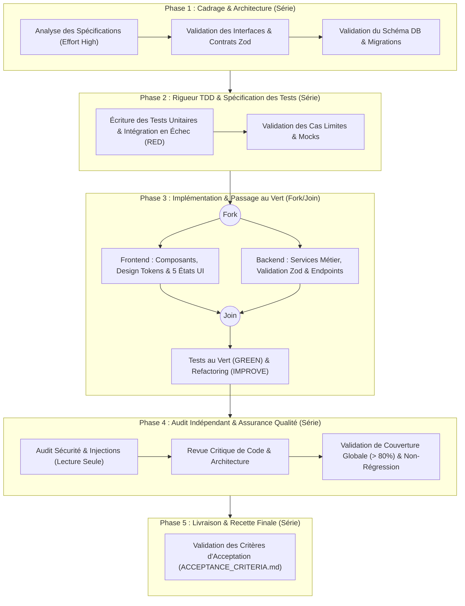

# Politique d'Orchestration et de Délégation — antigravity-harness-builder

Ce document définit la méthode de travail de l'agent principal Google Antigravity et les règles de délégation vers les sous-agents spécialisés, sans remplacer le mécanisme natif d'orchestration d'Antigravity (§6 CDC).

---

## 1. Cycle de Travail et Décomposition des Tâches (§6.1 & §6.4)

Pour chaque fonctionnalité ou lot de développement, l'agent principal doit suivre ce cycle proportionné :

1. **Analyser la demande et les critères d'acceptation** dans `docs/ACCEPTANCE_CRITERIA.md` et vérifier l'absence d'ambiguïté bloquante dans `docs/ASSUMPTIONS.md`.
2. **Décomposer le travail en tâches atomiques** avec leurs dépendances explicites.
3. **Identifier les tâches parallélisables sans conflit d'écriture** (ex: exploration documentaire ou revue sur des périmètres disjoints).
4. **Déléguer uniquement lorsque le gain est justifié** : éviter la délégation systématique pour des modifications simples d'un seul fichier et interdire les chaînes de délégation récursives inutiles.
5. **Exécuter en série** toutes les tâches dépendantes ou modifiant les mêmes fichiers/modules.
6. **Limiter la concurrence** (maximum 2 à 3 sous-agents actifs simultanément) pour préserver la lisibilité et le budget de tokens.
7. **Revue indépendante obligatoire** : faire relire les changements critiques par un sous-agent de revue en lecture seule (qui ne possède aucun outil d'écriture).
8. **Rigueur TDD systématique** : écrire les tests automatisés d'abord (RED), implémenter pour satisfaire le test (GREEN), puis refactorer (IMPROVE).

### Diagramme de Flux de Développement

---

## 2. Gouvernance Centralisée du Couple Modèle / Niveau d'Effort (§6.3)

Aucun sous-agent (`.agents/agents/<name>.md`) n'embarque de propriété `model` dans son frontmatter YAML. Le choix du couple **Modèle / Niveau d'effort** est intégralement piloté par la règle permanente `.agents/rules/model-effort-governance.md` (`trigger: always_on`) :

1. **Tâche courte** (question, relecture, correction bornée dans un seul fichier) : exécution directe, sans commentaire sur le modèle.
2. **Tâche longue ou à enjeu :** avant de commencer, une seule fois, l'agent principal compare le réglage actif au couple conseillé ; si l'écart est net, il formule **un seul couple préconisé** en une phrase et poursuit immédiatement.
3. **Action difficilement réversible (migration destructive, suppression, refonte appliquée au code) :** si le réglage actif est inférieur au couple préconisé (`Flagship — Effort High`), l'agent s'arrête et demande à l'utilisateur de modifier `Model Selection`. Planifier ou analyser n'est jamais une raison de s'arrêter.
4. **Délégation proportionnée :** un sous-agent n'est sollicité que pour une sous-tâche indépendante, bornée et volumineuse ; les revues et audits sont en lecture seule.

### Matrice des Sous-Agents Retenus

| Sous-agent (`.agents/agents/`) | Rôle & Responsabilité | Couple Unique Préconisé (Session) | Justification Qualité / Coût | Outils Autorisés (Moindre Privilège) |
| :--- | :--- | :--- | :--- | :--- |
| `architect` | architect | **`Flagship — Effort High`** | Couple Flagship — Effort High : raisonnement approfondi requis pour l’architecture, la performance critique, la sécurité et la revue indépendante. | `view_file, grep_search, find_by_name` |
| `code-reviewer` | code-reviewer | **`Flagship — Effort High`** | Couple Flagship — Effort High : raisonnement approfondi requis pour l’architecture, la performance critique, la sécurité et la revue indépendante. | `view_file, grep_search, find_by_name, run_command` |
| `database-reviewer` | database-reviewer | **`Flagship — Effort High`** | Couple Flagship — Effort High : raisonnement approfondi requis pour l’architecture, la performance critique, la sécurité et la revue indépendante. | `view_file, grep_search, find_by_name, run_command` |
| `react-reviewer` | react-reviewer | **`Flagship — Effort High`** | Couple Flagship — Effort High : raisonnement approfondi requis pour l’architecture, la performance critique, la sécurité et la revue indépendante. | `view_file, grep_search, find_by_name, run_command` |
| `security-auditor` | Auditeur de Sécurité & Conformité OWASP | **`Flagship — Effort High`** | Couple Flagship — Effort High : raisonnement approfondi requis pour l’architecture, la performance critique, la sécurité et la revue indépendante. | `view_file, grep_search, find_by_name, run_command` |
| `ui-craft-reviewer` | Revue Craft UI, Finitions et Accessibilité | **`Flagship — Effort High`** | Couple Flagship — Effort High : raisonnement approfondi requis pour l’architecture, la performance critique, la sécurité et la revue indépendante. | `view_file, grep_search, find_by_name` |
| `react-build-resolver` | react-build-resolver | **`Flagship — Effort Medium`** | Couple Flagship — Effort Medium : ratio coût/performance optimal pour l’ingénierie standard, le TDD et la résolution chirurgicale d’erreurs. | `view_file, write_to_file, replace_file_content, run_command, grep_search, find_by_name` |

---

## 3. Conditions de Déclenchement des Skills (`.agents/skills/`)

Les skills utilisent la **divulgation progressive** d'Antigravity : seuls leur nom et leur description sont chargés initialement. L'agent principal ou les sous-agents doivent activer explicitement le skill approprié lors des tâches suivantes :

- **`backend-patterns`** (`.agents/skills/backend-patterns/SKILL.md`) : Backend architecture patterns, API design, database optimization, and server-side best practices for Node.js, Express, and Next.js API routes. Use when building or reviewing Node.js, Express, or Next.js API routes and their data access.
  - *Raison de sélection :* Fonction « skill:backend:patterns » (source ecc-official). Correspondance directe avec les langages [typescript]. Adapté aux frameworks utilisés [next.js, react, tailwind css]. Mots-clés pertinents détectés : lang:typescript, framework:nextjs, sql, api. Sélectionné au titre du Pack d'Excellence Sécurité Renforcée (protection OWASP et Zero-Trust).
- **`deployment-patterns`** (`.agents/skills/deployment-patterns/SKILL.md`) : Deployment workflows, CI/CD pipeline patterns, Docker containerization, health checks, rollback strategies, and production readiness checklists for web applications. Use when setting up CI/CD, containerizing an app, or checking production readiness before a release.
  - *Raison de sélection :* Fonction « skill:ops:deployment » (source ecc-official). Correspondance directe avec les langages [typescript]. Mots-clés pertinents détectés : lang:typescript, postgresql, docker, api. Sélectionné au titre du Pack d'Excellence Sécurité Renforcée (protection OWASP et Zero-Trust).
- **`frontend-patterns`** (`.agents/skills/frontend-patterns/SKILL.md`) : Frontend development patterns for React, Next.js, state management, performance optimization, and UI best practices. Use when building or reviewing React or Next.js components, state, or render performance.
  - *Raison de sélection :* Fonction « skill:frontend:patterns » (source ecc-official). Correspondance directe avec les langages [typescript]. Adapté aux frameworks utilisés [next.js, react, tailwind css]. Mots-clés pertinents détectés : lang:typescript, framework:nextjs, framework:react, api. Sélectionné au titre du Pack d'Excellence Design & Craft UI (règle des 5 états et accessibilité).
- **`react-testing`** (`.agents/skills/react-testing/SKILL.md`) : React component testing with React Testing Library, Vitest/Jest, MSW for network mocking, accessibility assertions with axe, and the decision boundary between component tests and Playwright/Cypress end-to-end runs. Use when writing or fixing tests for React components, hooks, or pages.
  - *Raison de sélection :* Fonction « skill:stack:react:testing » (source ecc-official). Adapté aux frameworks utilisés [next.js, react, tailwind css]. Mots-clés pertinents détectés : framework:nextjs, framework:react, vitest, tdd. Répond aux contraintes d'architecture ou de sécurité spécifiées. Sélectionné au titre du Pack d'Excellence Design & Craft UI (règle des 5 états et accessibilité). Sélectionné au titre du Pack d'Excellence Rigueur TDD (prévention des régressions et zéro oubli). Synergie d'écosystème renforcée avec la stack et les outils du projet.
- **`security-review`** (`.agents/skills/security-review/SKILL.md`) : Use this skill when adding authentication, handling user input, working with secrets, creating API endpoints, or implementing payment/sensitive features. Provides comprehensive security checklist and patterns.
  - *Raison de sélection :* Fonction « skill:security:review » (source ecc-official). Correspondance directe avec les langages [typescript]. Adapté aux frameworks utilisés [next.js, react, tailwind css]. Mots-clés pertinents détectés : lang:typescript, framework:nextjs, framework:react, sql. Répond aux contraintes d'architecture ou de sécurité spécifiées. Sélectionné au titre du Pack d'Excellence Sécurité Renforcée (protection OWASP et Zero-Trust). Sélectionné au titre du Pack d'Excellence Rigueur TDD (prévention des régressions et zéro oubli). Synergie d'écosystème renforcée avec la stack et les outils du projet.
- **`tdd-workflow`** (`.agents/skills/tdd-workflow/SKILL.md`) : Test-driven development workflow: write a failing test first, watch it fail, implement the smallest change to green, then refactor with 80%+ coverage across unit, integration, and E2E tests. Use when writing a new feature, fixing a bug, refactoring, or when told to write failing tests first.
  - *Raison de sélection :* Fonction « skill:workflow:tdd » (source ecc-official). Correspondance directe avec les langages [typescript]. Adapté aux frameworks utilisés [next.js, react, tailwind css]. Mots-clés pertinents détectés : lang:typescript, framework:react, vitest, tdd. Sélectionné au titre du Pack d'Excellence Rigueur TDD (prévention des régressions et zéro oubli). Synergie d'écosystème renforcée avec la stack et les outils du projet.
- **`typescript-patterns`** (`.agents/skills/typescript-patterns/SKILL.md`) : TypeScript patterns for strict, type-safe, maintainable code in modern TypeScript and JavaScript applications. Covers strict compiler configuration, type design, narrowing, discriminated unions, generics, async and error handling, module boundaries, dependency hygiene, and type-level testing. Use when writing or reviewing TypeScript or JavaScript code.
  - *Raison de sélection :* Fonction « skill:stack:typescript:patterns » (source ecc-official). Correspondance directe avec les langages [typescript]. Adapté aux frameworks utilisés [next.js, react, tailwind css]. Mots-clés pertinents détectés : lang:typescript, lang:javascript, framework:nextjs, framework:react. Sélectionné au titre du Pack d'Excellence Rigueur TDD (prévention des régressions et zéro oubli).
- **`verification-loop`** (`.agents/skills/verification-loop/SKILL.md`) : Run a six-phase verification of a Claude Code session's work — build, type check, lint, tests with coverage, security grep, and diff review — then produce a PASS/FAIL verification report. Use when verifying work after completing a feature or refactor, before creating a PR, or when quality gates must pass.
  - *Raison de sélection :* Fonction « skill:workflow:verification » (source ecc-official). Correspondance directe avec les langages [typescript]. Mots-clés pertinents détectés : lang:typescript, lang:javascript, api, pack:security-hardened. Sélectionné au titre du Pack d'Excellence Sécurité Renforcée (protection OWASP et Zero-Trust).
- **`react-patterns`** (`.agents/skills/react-patterns/SKILL.md`) : React 18/19 patterns including hooks discipline, server/client component boundaries, Suspense + error boundaries, form actions, data fetching, state management decision trees, and accessibility-first composition. Use when writing or reviewing React components.
  - *Raison de sélection :* Fonction « skill:stack:react:patterns » (source ecc-official). Adapté aux frameworks utilisés [next.js, react, tailwind css]. Mots-clés pertinents détectés : framework:nextjs, framework:react, api, pack:security-hardened. Sélectionné au titre du Pack d'Excellence Sécurité Renforcée (protection OWASP et Zero-Trust). Sélectionné au titre du Pack d'Excellence Design & Craft UI (règle des 5 états et accessibilité). Sélectionné au titre du Pack d'Excellence Rigueur TDD (prévention des régressions et zéro oubli).
- **`api-design`** (`.agents/skills/api-design/SKILL.md`) : REST API design patterns including resource naming, status codes, pagination, filtering, error responses, versioning, and rate limiting for production APIs. Use when designing or reviewing REST endpoints, resource names, status codes, pagination, or versioning.
  - *Raison de sélection :* Fonction « skill:backend:api-design » (source ecc-official). Correspondance directe avec les langages [typescript]. Adapté aux frameworks utilisés [next.js, react, tailwind css]. Mots-clés pertinents détectés : lang:typescript, framework:nextjs, sql, api.
- **`frontend-a11y`** (`.agents/skills/frontend-a11y/SKILL.md`) : Accessibility patterns for React and Next.js — semantic HTML, ARIA attributes, form labeling, keyboard navigation, focus management, and screen reader support. Use when building or reviewing forms, modals, dropdowns, tooltips, or tabs, fixing a11y lint or code-review findings, or wiring up keyboard navigation and focus management.
  - *Raison de sélection :* Fonction « skill:ui:accessibility » (source ecc-official). Préféré à : accessibility. Adapté aux frameworks utilisés [next.js, react, tailwind css]. Mots-clés pertinents détectés : framework:nextjs, framework:react, pack:design-craft-polish. Sélectionné au titre du Pack d'Excellence Design & Craft UI (règle des 5 états et accessibilité).
- **`database-migrations`** (`.agents/skills/database-migrations/SKILL.md`) : Safe, reversible database migration patterns: forward-only production changes, expand-contract zero-downtime renames, concurrent indexes, batched backfills, and per-tool workflows for PostgreSQL, Prisma, Drizzle, Kysely, Django, and golang-migrate. Use when writing a schema or data migration, adding a column or index to a large table, planning a rollback, or preparing a zero-downtime deploy.
  - *Raison de sélection :* Fonction « skill:database:migrations » (source ecc-official). Correspondance directe avec les langages [typescript]. Mots-clés pertinents détectés : lang:typescript, sql, postgresql, database_focus. Répond aux contraintes d'architecture ou de sécurité spécifiées.
- **`docker-patterns`** (`.agents/skills/docker-patterns/SKILL.md`) : Docker and Docker Compose patterns for local development, hardened CLI installer harnesses, container security, networking, volumes, and multi-service orchestration. Use when creating or reviewing Dockerfiles and Compose services, testing installers across Linux distributions, or planning accurate native macOS and Windows validation.
  - *Raison de sélection :* Fonction « skill:stack:docker:patterns » (source ecc-official). Mots-clés pertinents détectés : sql, postgresql, docker, api. Sélectionné au titre du Pack d'Excellence Sécurité Renforcée (protection OWASP et Zero-Trust). Sélectionné au titre du Pack d'Excellence Rigueur TDD (prévention des régressions et zéro oubli).
- **`postgres-patterns`** (`.agents/skills/postgres-patterns/SKILL.md`) : PostgreSQL database patterns for query optimization, schema design, indexing, and security. Based on Supabase best practices. Use when designing PostgreSQL schemas, indexes, or RLS policies, or when a query is too slow.
  - *Raison de sélection :* Fonction « skill:stack:postgres:patterns » (source ecc-official). Mots-clés pertinents détectés : sql, postgresql, api, pack:security-hardened. Sélectionné au titre du Pack d'Excellence Sécurité Renforcée (protection OWASP et Zero-Trust).
- **`design-system`** (`.agents/skills/design-system/SKILL.md`) : Generate a design system from an existing codebase or audit one for visual consistency: extract tokens (colors, typography, spacing, shadows) into design-tokens.json and CSS custom properties with DESIGN.md rationale and an interactive HTML preview, score the UI across 10 dimensions, and flag AI-slop patterns. Use when starting a design system, auditing visual consistency before a redesign, or reviewing a PR that touches styling.
  - *Raison de sélection :* Fonction « skill:ui:design-system » (source ecc-official). Mots-clés pertinents détectés : pack:design-craft-polish. Sélectionné au titre du Pack d'Excellence Design & Craft UI (règle des 5 états et accessibilité).
- **`frontend-design-direction`** (`.agents/skills/frontend-design-direction/SKILL.md`) : Set an ECC-specific frontend design direction for production UI work. Use when building or improving websites, dashboards, applications, components, landing pages, visual tools, or any web UI that needs stronger product-specific design judgment.
  - *Raison de sélection :* Fonction « skill:ui:design-engineering » (source ecc-official). Préféré à : make-interfaces-feel-better. Mots-clés pertinents détectés : pack:design-craft-polish. Sélectionné au titre du Pack d'Excellence Design & Craft UI (règle des 5 états et accessibilité).

### Matrice d'Activation par Phase du Projet

| Phase de Développement | Compétences (Skills) Mobilisables | Rôles Habilités | Déclencheur Opérationnel |
| :--- | :--- | :--- | :--- |
| **Cadrage & Exploration** | `deployment-patterns`, `typescript-patterns`, `verification-loop`, `docker-patterns`, `postgres-patterns`, `design-system` | Agent Principal, Architect | Exploration initiale et formulation de prompts |
| **Conception & API** | `backend-patterns`, `api-design` | Backend Engineer, Agent Principal | Définition des schémas d'API et routes |
| **Persistance & Schéma** | `database-migrations` | Backend Engineer | Écriture de requêtes SQL et migrations |
| **Interface & Finitions** | `frontend-patterns`, `react-testing`, `react-patterns`, `frontend-a11y`, `frontend-design-direction` | Frontend Engineer | Développement des composants et respect du Design System |
| **Rigueur & Tests TDD** | `tdd-workflow` | QA, Développeur | Avant toute implémentation (Red-Green-Refactor) |
| **Revue & Sécurité** | `security-review` | Security / Code Reviewer | Inspection préalable à toute fusion de code |

---

## 4. Protocole de Délégation et Handoff Inter-Agents

1. **Modes d'Isolation de l'Espace de Travail (`Workspace`)** :
   - `inherit` : Mode standard sans duplication. Utilisé pour les audits en lecture seule et les modifications de fichiers ciblés.
   - `share` : Partage du dépôt sous-jacent (similaire à `git worktree`). Recommandé pour le travail parallèle sans collision de compilation.
   - `branch` : Espace de travail isolé et cloné. Recommandé pour les refactorisations lourdes et expérimentations.

2. **Fiche de Mission pour Sous-Agent** :
   Chaque délégation vers un sous-agent doit obligatoirement formaliser :
   - Le contexte et l'objectif borné de la sous-tâche.
   - Les fichiers autorisés en lecture/écriture.
   - Les critères d'acceptation univoques.
   - L'interdiction d'effets de bord non sollicités.

3. **Validation Préalable à la Fusion** :
   L'agent parent inspecte systématiquement le livrable et lance les tests unitaires avant de clore la tâche déléguée.

---

## 5. Commandes Slash à Suggérer

Suggérez une commande uniquement quand elle change réellement la façon de travailler, une seule fois par sujet, en une phrase. Ne l'imposez pas.

- **`/plan`** : Fonctionnalité complexe ou modification touchant plusieurs fichiers, avant d'écrire du code. Explore le code, pose les questions nécessaires et produit un plan relisible.
- **`/goal`** : Jalon complet à mener sans interruption une fois le plan validé. Poursuit l'objectif de façon autonome jusqu'à son accomplissement.
- **`/teamwork`** : Chantier de grande ampleur (migration sur tout le dépôt, recherche) justifiant plusieurs agents. Réunit une équipe d'agents collaborant sur le chantier.
- **`/boost`** : Bogue difficile, condition de concurrence ou algorithme ardu. Raisonnement approfondi par plusieurs agents.
- **`/grill-me`** : Besoin ou décision encore flou avant de commencer. Interroge l'utilisateur question par question, avec une réponse recommandée à chacune.
- **`/learn`** : Correction ou convention réutilisable donnée par l’utilisateur en cours de session. Transforme les corrections de la session en règles ou skills persistants.

Les procédures réutilisables sont des skills (`.agents/skills/`) ; les workflows (`.agents/workflows/`) sont voués à disparaître (arrêt annoncé au 19 octobre 2026, encore exécutés par certaines versions).