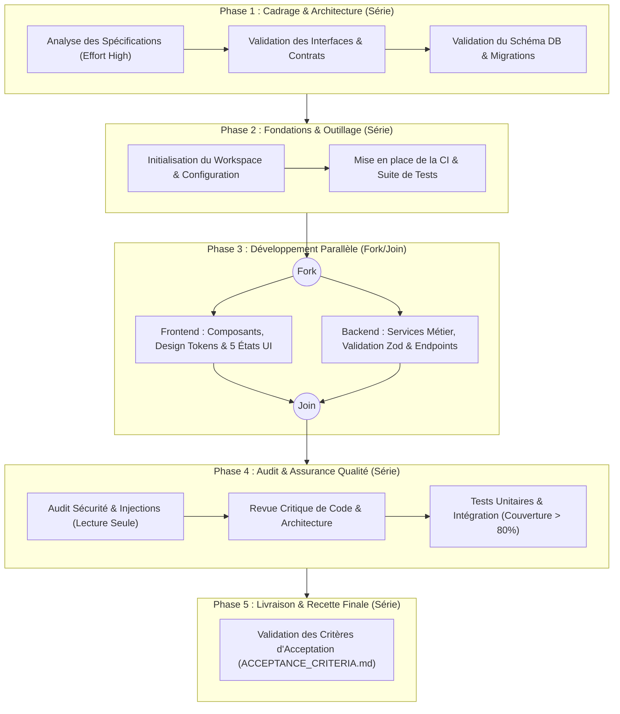

# Politique d'Orchestration et de Délégation — antigravity-harness-builder

Ce document définit la méthode de travail de l'agent principal Google Antigravity et les règles de délégation vers les sous-agents spécialisés, sans remplacer le mécanisme natif d'orchestration d'Antigravity (§6 CDC).

---

## 1. Cycle de Travail et Décomposition des Tâches (§6.1 & §6.4)

Pour chaque fonctionnalité ou lot de développement, l'agent principal doit suivre ce cycle proportionné :

1. **Analyser la demande et les critères d'acceptation** dans `docs/ACCEPTANCE_CRITERIA.md` et vérifier l'absence d'ambiguïté bloquante dans `docs/ASSUMPTIONS.md`.
2. **Décomposer le travail en tâches atomiques** avec leurs dépendances explicites.
3. **Identifier les tâches parallélisables sans conflit d'écriture** (ex: exploration documentaire ou revue sur des périmètres disjoints).
4. **Déléguer uniquement lorsque le gain est justifié** : éviter la délégation systématique pour des modifications simples d'un seul fichier et interdire les chaînes de délégation récursives inutiles.
5. **Exécuter en série** toutes les tâches dépendantes ou modifiant les mêmes fichiers/modules.
6. **Limiter la concurrence** (maximum 2 à 3 sous-agents actifs simultanément) pour préserver la lisibilité et le budget de tokens.
7. **Revue indépendante obligatoire** : faire relire les changements critiques par un sous-agent de revue en lecture seule (qui ne possède aucun outil d'écriture).
8. **Lancer les tests automatisés pertinents** à chaque fonctionnalité livrée, et pas uniquement à la fin du projet.

### Diagramme de Flux de Développement

---

## 2. Gouvernance Centralisée du Couple Modèle / Niveau d'Effort (§6.3)

Aucun sous-agent (`.agents/agents/<name>.md`) n'embarque de propriété `model` dans son frontmatter YAML. Le choix du couple **Modèle / Niveau d'effort** est intégralement piloté par la règle permanente `.agents/rules/model-effort-governance.md` (`trigger: always_on`) :

1. **Tâche courte** (question, relecture, correction bornée dans un seul fichier) : exécution directe, sans commentaire sur le modèle.
2. **Tâche longue ou à enjeu :** avant de commencer, une seule fois, l'agent principal compare le réglage actif (`Model Selection`, visible via `<USER_SETTINGS_CHANGE>`) au couple conseillé ; si l'écart est net, il formule **un seul couple préconisé** en une phrase et poursuit immédiatement.
3. **Action difficilement réversible (migration destructive, suppression, refonte appliquée au code) :** si le réglage actif est inférieur au couple préconisé, l'agent s'arrête et demande à l'utilisateur de modifier `Model Selection`. Planifier ou analyser n'est jamais une raison de s'arrêter.
4. **Délégation proportionnée :** un sous-agent n'est sollicité que pour une sous-tâche indépendante, bornée et volumineuse ; les revues et audits sont en lecture seule.

### Matrice des Sous-Agents Retenus

| Sous-agent (`.agents/agents/`) | Rôle & Responsabilité | Couple Unique Préconisé (Session) | Justification Qualité / Coût | Outils Autorisés (Moindre Privilège) |
| :--- | :--- | :--- | :--- | :--- |
| `build-error-resolver` | Résolution d'erreurs de build et TypeScript | **`Pro — Effort Medium`** | Compromis coût/performance optimal pour corriger les erreurs de typage sans dérive architecturale. | `view_file, write_to_file, replace_file_content, run_command, grep_search, find_by_name` |
| `code-reviewer` | Revue indépendante de code, qualité et maintenabilité | **`Pro — Effort High`** | Raisonnement approfondi requis pour l'audit critique en lecture seule. | `view_file, grep_search, find_by_name, run_command` |
| `performance-optimizer` | Analyse de performance et optimisation runtime | **`Pro — Effort High`** | Raisonnement approfondi requis pour le profilage et l'optimisation algorithmique. | `view_file, write_to_file, replace_file_content, run_command, grep_search, find_by_name` |
| `security-auditor` | Auditeur de Sécurité & Conformité OWASP | **`Pro — Effort High`** | Raisonnement approfondi requis pour l'audit critique de sécurité. | `view_file, grep_search, find_by_name, run_command` |
| `react-build-resolver` | Résolution d'erreurs de build React / Next.js | **`Pro — Effort Medium`** | Précision chirurgicale sur les frontières JSX/Server/Client sans surcoût excessif. | `view_file, write_to_file, replace_file_content, run_command, grep_search, find_by_name` |
| `refactor-cleaner` | Suppression de code mort et consolidation | **`Pro — Effort Medium`** | Fiabilité élevée pour vérifier les graphes d'imports avant nettoyage. | `view_file, write_to_file, replace_file_content, run_command, grep_search, find_by_name` |
| `doc-updater` | Mise à jour de documentation et codemaps | **`Flash — Effort Low`** | Latence minimale et coût très réduit pour la maintenance documentaire. | `view_file, write_to_file, replace_file_content, run_command, grep_search, find_by_name` |

---

## 3. Conditions de Déclenchement des Skills (`.agents/skills/`)

Les skills utilisent la **divulgation progressive** d'Antigravity : seuls leur nom et leur description sont chargés initialement. L'agent principal ou les sous-agents doivent activer explicitement le skill approprié lors des tâches suivantes :

- **`react-test`** (`.agents/skills/react-test/SKILL.md`) : Enforce TDD workflow for React. Write React Testing Library tests first (behavior-focused, accessibility-first), then implement components. Detects Vitest or Jest and verifies coverage targets.
  - *Raison de sélection :* Adapté aux frameworks utilisés [next.js, react, tailwind css]. Mots-clés pertinents détectés : framework:react, vitest, api, testing_focus. Répond aux contraintes d'architecture ou de sécurité spécifiées. Sélectionné au titre du Pack d'Excellence Design & Craft UI (règle des 5 états et accessibilité). Sélectionné au titre du Pack d'Excellence Rigueur TDD (prévention des régressions et zéro oubli). Synergie d'écosystème renforcée avec la stack et les outils du projet.
- **`agent-payment-x402`** (`.agents/skills/agent-payment-x402/SKILL.md`) : Add x402 payment execution to AI agents with per-task budgets, spending controls, and non-custodial wallets. Supports Base through agentwallet-sdk, X Layer through OKX Payments / OKX Agent Payments Protocol, and Solana plus multi-network EVM through the upstream x402 packages with facilitator-based settlement. Use when an agent must pay for something itself and needs per-task budgets, spending controls, and a non-custodial wallet.
  - *Raison de sélection :* Correspondance directe avec les langages [typescript]. Adapté aux frameworks utilisés [next.js, react, tailwind css]. Mots-clés pertinents détectés : lang:typescript, lang:java, framework:nextjs, skill. Sélectionné au titre du Pack d'Excellence Sécurité Renforcée (protection OWASP et Zero-Trust).
- **`ai-regression-testing`** (`.agents/skills/ai-regression-testing/SKILL.md`) : Regression testing strategies for AI-assisted development. Sandbox-mode API testing without database dependencies, automated bug-check workflows, and patterns to catch AI blind spots where the same model writes and reviews code. Use when adding regression coverage to AI-assisted code, or when the same model both wrote and reviewed a change.
  - *Raison de sélection :* Correspondance directe avec les langages [typescript]. Adapté aux frameworks utilisés [next.js, react, tailwind css]. Mots-clés pertinents détectés : lang:typescript, framework:nextjs, skill, vitest. Répond aux contraintes d'architecture ou de sécurité spécifiées. Sélectionné au titre du Pack d'Excellence Rigueur TDD (prévention des régressions et zéro oubli). Synergie d'écosystème renforcée avec la stack et les outils du projet.
- **`backend-patterns`** (`.agents/skills/backend-patterns/SKILL.md`) : Backend architecture patterns, API design, database optimization, and server-side best practices for Node.js, Express, and Next.js API routes. Use when building or reviewing Node.js, Express, or Next.js API routes and their data access.
  - *Raison de sélection :* Correspondance directe avec les langages [typescript]. Adapté aux frameworks utilisés [next.js, react, tailwind css]. Mots-clés pertinents détectés : lang:typescript, framework:nextjs, skill, sql. Sélectionné au titre du Pack d'Excellence Sécurité Renforcée (protection OWASP et Zero-Trust).
- **`bun-runtime`** (`.agents/skills/bun-runtime/SKILL.md`) : Bun as runtime, package manager, bundler, and test runner. When to choose Bun vs Node, migration notes, and Vercel support.
  - *Raison de sélection :* Correspondance directe avec les langages [typescript]. Mots-clés pertinents détectés : lang:typescript, lang:javascript, skill, sql. Sélectionné au titre du Pack d'Excellence Sécurité Renforcée (protection OWASP et Zero-Trust). Sélectionné au titre du Pack d'Excellence Rigueur TDD (prévention des régressions et zéro oubli).
- **`click-path-audit`** (`.agents/skills/click-path-audit/SKILL.md`) : Trace every user-facing button/touchpoint through its full state change sequence to find bugs where functions individually work but cancel each other out, produce wrong final state, or leave the UI in an inconsistent state. Use when: systematic debugging found no bugs but users report broken buttons, or after any major refactor touching shared state stores.
  - *Raison de sélection :* Adapté aux frameworks utilisés [next.js, react, tailwind css]. Mots-clés pertinents détectés : framework:react, skill, api, pack:security-hardened. Sélectionné au titre du Pack d'Excellence Sécurité Renforcée (protection OWASP et Zero-Trust). Synergie d'écosystème renforcée avec la stack et les outils du projet.
- **`codebase-onboarding`** (`.agents/skills/codebase-onboarding/SKILL.md`) : Analyze an unfamiliar codebase and generate a structured onboarding guide with architecture map, key entry points, conventions, and a starter CLAUDE.md. Use when joining a new project or setting up Claude Code for the first time in a repo.
  - *Raison de sélection :* Correspondance directe avec les langages [typescript]. Adapté aux frameworks utilisés [next.js, react, tailwind css]. Mots-clés pertinents détectés : lang:typescript, framework:nextjs, framework:react, skill. Sélectionné au titre du Pack d'Excellence Rigueur TDD (prévention des régressions et zéro oubli).
- **`coding-standards`** (`.agents/skills/coding-standards/SKILL.md`) : Baseline cross-project coding conventions for naming, readability, immutability, and code-quality review. Use detailed frontend or backend skills for framework-specific patterns. Use when reviewing code quality or naming with no framework-specific skill that applies.
  - *Raison de sélection :* Correspondance directe avec les langages [typescript]. Adapté aux frameworks utilisés [next.js, react, tailwind css]. Mots-clés pertinents détectés : lang:typescript, lang:javascript, framework:nextjs, framework:react. Sélectionné au titre du Pack d'Excellence Rigueur TDD (prévention des régressions et zéro oubli).
- **`deployment-patterns`** (`.agents/skills/deployment-patterns/SKILL.md`) : Deployment workflows, CI/CD pipeline patterns, Docker containerization, health checks, rollback strategies, and production readiness checklists for web applications. Use when setting up CI/CD, containerizing an app, or checking production readiness before a release.
  - *Raison de sélection :* Correspondance directe avec les langages [typescript]. Mots-clés pertinents détectés : lang:typescript, skill, postgresql, docker. Sélectionné au titre du Pack d'Excellence Sécurité Renforcée (protection OWASP et Zero-Trust).
- **`frontend-patterns`** (`.agents/skills/frontend-patterns/SKILL.md`) : Frontend development patterns for React, Next.js, state management, performance optimization, and UI best practices. Use when building or reviewing React or Next.js components, state, or render performance.
  - *Raison de sélection :* Correspondance directe avec les langages [typescript]. Adapté aux frameworks utilisés [next.js, react, tailwind css]. Mots-clés pertinents détectés : lang:typescript, framework:nextjs, framework:react, skill. Sélectionné au titre du Pack d'Excellence Design & Craft UI (règle des 5 états et accessibilité).
- **`gateguard`** (`.agents/skills/gateguard/SKILL.md`) : PreToolUse fact-forcing gate that denies the first Edit/Write/Bash (including MultiEdit and NotebookEdit) attempt until the agent presents concrete facts (importers, data schemas, verbatim user instruction), then allows retry; A/B-tested at +2.25 quality points. Use when enabling or configuring the GateGuard hook, exempting paths via env vars, or handling first-touch denials.
  - *Raison de sélection :* Correspondance directe avec les langages [typescript]. Mots-clés pertinents détectés : lang:java, skill, sql, api. Sélectionné au titre du Pack d'Excellence Sécurité Renforcée (protection OWASP et Zero-Trust).
- **`healthcare-phi-compliance`** (`.agents/skills/healthcare-phi-compliance/SKILL.md`) : Protected Health Information (PHI) and PII compliance patterns for healthcare applications: data classification, row-level access control, tamper-proof audit trails, schema tagging, and common leak vectors such as logs, URLs, and browser storage. Use when code touches patient or clinician data, when implementing HIPAA or GDPR access controls, or when auditing a healthcare system for data exposure.
  - *Raison de sélection :* Correspondance directe avec les langages [typescript]. Mots-clés pertinents détectés : lang:typescript, skill, sql, api. Sélectionné au titre du Pack d'Excellence Sécurité Renforcée (protection OWASP et Zero-Trust).
- **`mysql-patterns`** (`.agents/skills/mysql-patterns/SKILL.md`) : MySQL and MariaDB schema, query, indexing, transaction, replication, and connection-pool patterns for production backends. Use when designing MySQL or MariaDB schemas and indexes, or when a query, transaction, or replica lags.
  - *Raison de sélection :* Correspondance directe avec les langages [typescript]. Mots-clés pertinents détectés : lang:javascript, skill, sql, postgresql. Sélectionné au titre du Pack d'Excellence Sécurité Renforcée (protection OWASP et Zero-Trust).
- **`mybatis-patterns`** (`.agents/skills/mybatis-patterns/SKILL.md`) : MyBatis and MyBatis-Spring patterns for mapper design, XML and annotation SQL, result mapping, dynamic SQL safety, transactions, batching, pagination, and query performance. Use when building or reviewing Java persistence code with MyBatis, Spring Boot, MyBatis-Spring, or MyBatis-based legacy applications.
  - *Raison de sélection :* Correspondance directe avec les langages [typescript]. Mots-clés pertinents détectés : lang:java, skill, sql, postgresql. Sélectionné au titre du Pack d'Excellence Sécurité Renforcée (protection OWASP et Zero-Trust). Sélectionné au titre du Pack d'Excellence Rigueur TDD (prévention des régressions et zéro oubli).
- **`prompt-optimizer`** (`.agents/skills/prompt-optimizer/SKILL.md`) : Analyze draft prompts, detect intent and missing context, match ECC commands, skills, and agents, and output a ready-to-paste optimized prompt with diagnosis and rationale — advisory only, never executes the task. Use when the user says 'optimize prompt', 'improve my prompt', 'rewrite this prompt', 'help me prompt', 优化prompt, 改进prompt, 怎么写prompt, or 帮我优化这个指令; not for requests to optimize code or performance.
  - *Raison de sélection :* Correspondance directe avec les langages [typescript]. Adapté aux frameworks utilisés [next.js, react, tailwind css]. Mots-clés pertinents détectés : lang:typescript, lang:java, framework:nextjs, framework:react. Sélectionné au titre du Pack d'Excellence Sécurité Renforcée (protection OWASP et Zero-Trust). Sélectionné au titre du Pack d'Excellence Rigueur TDD (prévention des régressions et zéro oubli).
- **`react-testing`** (`.agents/skills/react-testing/SKILL.md`) : React component testing with React Testing Library, Vitest/Jest, MSW for network mocking, accessibility assertions with axe, and the decision boundary between component tests and Playwright/Cypress end-to-end runs. Use when writing or fixing tests for React components, hooks, or pages.
  - *Raison de sélection :* Adapté aux frameworks utilisés [next.js, react, tailwind css]. Mots-clés pertinents détectés : framework:nextjs, framework:react, skill, vitest. Répond aux contraintes d'architecture ou de sécurité spécifiées. Sélectionné au titre du Pack d'Excellence Design & Craft UI (règle des 5 états et accessibilité). Sélectionné au titre du Pack d'Excellence Rigueur TDD (prévention des régressions et zéro oubli). Synergie d'écosystème renforcée avec la stack et les outils du projet.
- **`security-review`** (`.agents/skills/security-review/SKILL.md`) : Use this skill when adding authentication, handling user input, working with secrets, creating API endpoints, or implementing payment/sensitive features. Provides comprehensive security checklist and patterns.
  - *Raison de sélection :* Correspondance directe avec les langages [typescript]. Adapté aux frameworks utilisés [next.js, react, tailwind css]. Mots-clés pertinents détectés : lang:typescript, framework:nextjs, framework:react, skill. Sélectionné au titre du Pack d'Excellence Sécurité Renforcée (protection OWASP et Zero-Trust). Sélectionné au titre du Pack d'Excellence Rigueur TDD (prévention des régressions et zéro oubli). Synergie d'écosystème renforcée avec la stack et les outils du projet.

### Matrice d'Activation par Phase du Projet

| Phase de Développement | Compétences (Skills) Mobilisables | Rôles Habilités | Déclencheur Opérationnel |
| :--- | :--- | :--- | :--- |
| **Cadrage & Exploration** | `codebase-onboarding`, `prompt-optimizer` | Agent Principal, Architect | Exploration initiale et formulation de prompts |
| **Conception & API** | `api-design`, `backend-patterns` | Backend Engineer, Agent Principal | Définition des schémas d'API et routes |
| **Persistance & Schéma** | `prisma-patterns` (ou Drizzle) | Backend Engineer | Écriture de requêtes SQL et migrations |
| **Interface & Finitions** | `frontend-patterns`, `react-testing` | Frontend Engineer | Développement des composants et respect du Design System |
| **Rigueur & Tests TDD** | `tdd-workflow`, `ai-regression-testing` | QA, Développeur | Avant toute implémentation (Red-Green-Refactor) |
| **Revue & Sécurité** | `security-review`, `coding-standards` | Security / Code Reviewer | Inspection préalable à toute fusion de code |

---

## 4. Protocole de Délégation et Handoff Inter-Agents

1. **Modes d'Isolation de l'Espace de Travail (`Workspace`)** :
   - `inherit` : Mode standard sans duplication. Utilisé pour les audits en lecture seule et les modifications de fichiers ciblés.
   - `share` : Partage du dépôt sous-jacent (similaire à `git worktree`). Recommandé pour le travail parallèle sans collision de compilation.
   - `branch` : Espace de travail isolé et cloné. Recommandé pour les refactorisations lourdes et expérimentations.

2. **Fiche de Mission pour Sous-Agent** :
   Chaque délégation vers un sous-agent doit obligatoirement formaliser :
   - Le contexte et l'objectif borné de la sous-tâche.
   - Les fichiers autorisés en lecture/écriture.
   - Les critères d'acceptation univoques.
   - L'interdiction d'effets de bord non sollicités.

3. **Validation Préalable à la Fusion** :
   L'agent parent inspecte systématiquement le livrable et lance les tests unitaires avant de clore la tâche déléguée.

---

## 5. Recommandations Proactives des Commandes Slash dans le Dialogue

L'agent principal doit assister l'utilisateur en lui recommandant proactivement les commandes slash adaptées au cours du dialogue :
- **`/plan`** : Dès qu'une tâche complexe nécessite d'aligner l'architecture ou la décomposition multi-étapes avant d'écrire du code.
- **`/goal`** : Dès que l'utilisateur confie un jalon complet ou un travail au long cours nécessitant de multiples étapes sans interruption.
- **`/teamwork`** : Dès qu'une tâche nécessite de mobiliser conjointement plusieurs sous-agents (architecte + BDD + reviewer).
- **`/boost`** : Pour un problème algorithmique particulièrement ardu nécessitant un raisonnement multi-perspectives approfondi.
- **`/grill-me`** : Besoin ou décision encore flou avant de commencer.
- **`/learn`** : Lorsque l'utilisateur donne une directive réutilisable ou corrige une convention sur le projet afin de la mémoriser durablement.
