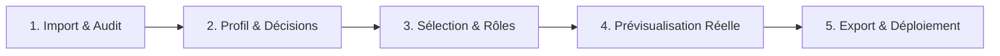

# Cahier des Charges Fonctionnel et Technique — Antigravity Harness Builder

**Nom du projet :** `antigravity-harness-builder`  
**Version de la spécification :** 2.0  
**Surface Antigravity cible :** `IDE`  
**Statut :** Implémenté, validé et vérifié par tests automatisés  

---

## 1. Vision et Objectifs du Produit

### 1.1 Objectif Général
**Antigravity Harness Builder** est une plateforme SaaS / d'ingénierie logicielle full-stack conçue pour générer de manière **déterministe, explicable, sécurisée et reproductible** des harnais d'instructions et de contexte pour les agents de développement **Google Antigravity**.

L'application transforme des documents de cadrage bruts (PRD, spécifications d'architecture, rapports d'audit de workspace `antigravity-audit.json`, contraintes d'équipe) en un ensemble complet de composants standardisés :
- Règles actives et contextuelles (`.agents/rules/*.md`)
- Compétences outillées (`.agents/skills/*/SKILL.md`)
- Définitions de sous-agents spécialisés (`.agents/agents/*.md`)
- Directives racine et gouvernance d'orchestration (`AGENTS.md`, `docs/ORCHESTRATION.md`, `docs/ARCHITECTURE.md`)
- Script de déploiement sécurisé avec sauvegarde automatique (`deploy.sh`) et prompt de mise à niveau assistée (`UPGRADE_PROMPT.md`).

### 1.2 Problématiques Résolues
1. **Fin du non-déterminisme des prompts libres :** Sélection algorithmique des règles et compétences basée sur des critères factuels (stack technique, surface, patterns, contraintes de sécurité).
2. **Explicabilité totale :** Chaque composant retenu ou rejeté fournit une justification claire, un score d'adéquation et son rôle fonctionnel précis.
3. **Gouvernance Coût / Performance optimale :** Centralisation du pilotage Modèle / Niveau d'effort pour éliminer le surcoût de tokens et prévenir les régressions sans figer de modèles statiques dans les sous-agents.
4. **Zéro-Trust et Intégrité :** Déploiement non destructif, sauvegardes pré-écriture systématiques, isolation multi-tenant et validation stricte des entrées.

---

## 2. Stack Technique et Architecture Système

- **Runtime & Langage :** Node.js / TypeScript (mode strict).
- **Framework Frontend & Backend :** Next.js 15 (App Router, Server Actions, Route Handlers), React 19.
- **Styling & Design System :** Tailwind CSS avec respect des Design Tokens Antigravity et implémentation systématique de la **Règle des 5 États UI** (Normal, Chargement / Skeleton, Vide, Erreur avec Retry, Feedback Toast).
- **Base de Données & ORM :** PostgreSQL avec Drizzle ORM (schémas typés, requêtes paramétrées, migrations versionnées).
- **Authentification & Sécurité :** Sessions basées sur cookies HTTP-only avec détection HTTPS dynamique, chiffrement de session et middleware d'isolation multi-tenant.
- **Extraction & LLM Gateway :** Passerelle LLM avec connecteur Gemini et mode d'extraction heuristique résiliente / mock déterministe hors-ligne.
- **Archivage & Export :** Générateur natif d'archives TAR.GZ déterministe et packageur ZIP.
- **Suite de Tests :** Vitest (13 suites, 77 tests automatisés validés, Golden Datasets).

---

## 3. Personas et Parcours Utilisateurs

### 3.1 Personas
- **Lead Developer / Architecte :** Configure le profil du projet, ajuste les décisions d'architecture incertaines, inspecte les composants retenus et télécharge le harnais prêt à l'emploi.
- **Développeur Produit :** Exécute le script `deploy.sh` dans son workspace pour bénéficier d'un agent Antigravity parfaitement calibré dès la première session.
- **Administrateur Plateforme :** Gère les sources externes de catalogue (ECC officiel, dépôts spécialisés) et déclenche la synchronisation multi-sources.

### 3.2 Parcours Utilisateur en 5 Étapes Aligné

---

## 4. Fonctionnalités et Spécifications Détaillées

### 4.1 Étape 1 : Ingestion Multi-Documents & Audit Automatisé
- **Saisie textuelle ou upload documentaire :** Ingestion de PRD, spécifications d'architecture, guidelines et contraintes d'équipe.
- **Ingestion directe du rapport d'audit workspace :** Route API `/api/projects/[id]/audit-ingest` permettant d'injecter directement le fichier `antigravity-audit.json`.
- **Extraction heuristique intelligente :** Détection automatique des langages, frameworks, bibliothèques d'UI, ORM, bases de données, outils de test et commandes réelles (`npm run dev`, `npm test`, `npm run build`, `npm run lint`).
- **Préservation des directives existantes :** Récupération des règles déjà appliquées par l'équipe pour empêcher tout écrasement ou régression.

### 4.2 Étape 2 : Profil de Projet & Résolution Interactive des Décisions Humaines
- **Synthèse structurée du profil :** Normalisation des informations du projet (nom, surface cible, technologies détectées, contraintes de sécurité et de déploiement).
- **Module interactif de résolution des incertitudes :** Présentation des hypothèses ouvertes, incertitudes techniques ou choix ambigus issus de `docs/ASSUMPTIONS.md`.
- **Contrôle humain préalable :** L'utilisateur peut valider, amender ou résoudre chaque incertitude directement dans l'UI avant de figer le profil et de déclencher la sélection.

### 4.3 Étape 3 : Moteur de Sélection Déterministe & Rôles des Composants
- **Algorithme de Scoring Multi-Critères :** Calcul déterministe d'adéquation basé sur la stack, la surface cible (IDE, CLI, Agent autonome) et les patterns détectés.
- **Règles d'incompatibilité et filtres stricts :** Filtrage exclusif des technologies non compatibles (ex. exclusion des compétences web inadéquates lors de projets Expo / React Native purs).
- **Bonus Craft UI & Design Engineering :** Attribution d'un bonus de pertinence pour les règles et compétences de Design Engineering et Micro-interactions lorsque le projet inclut React, Next.js ou Tailwind CSS.
- **Déduplication intelligente des sous-agents :** Prévention des doublons fonctionnels entre agents généralistes et spécialistes.
- **Rôle fonctionnel explicite :** Chaque composant retenu affiche un libellé clair décrivant son rôle précis dans le harnais.
- **Onglets de filtrage par catégorie :** Interface unifiée avec bascule par onglets (*Toutes, Règles, Compétences, Sous-agents*) et visionneuse des candidats rejetés avec motif explicable.
- **Synthèse de règles personnalisées :** Génération de règles de projet spécifiques issues des directives métier existantes de l'équipe (`custom-rules-synthesizer`).

### 4.4 Étape 4 : Prévisualisation Intégrale avec Viewer de Fichiers Réels
- **Arborescence fidèle du harnais :** Navigation visuelle dans la hiérarchie complète (`AGENTS.md`, `docs/`, `.agents/rules/`, `.agents/skills/`, `.agents/agents/`).
- **Affichage du contenu réel :** Inspection du code et du texte markdown exacts générés pour chaque fichier (pas de simulation factice ou de placeholder).
- **Badges contextuels :** Identification immédiate du type de composant, du déclencheur (`always_on`, `glob`) et de la surface d'exécution.

### 4.5 Étape 5 : Export Multi-Formats, Déploiement et Gouvernance Modèle / Effort
- **Téléchargement d'archives :** Export direct au format ZIP ou TAR.GZ déterministe (`tar-builder.ts`).
- **Script d'installation automatisé (`deploy.sh`) :**
  - Sauvegarde préalable automatique du dossier `.agents/` et de `AGENTS.md` sous `.agents.backup-<timestamp>/`.
  - Installation chirurgicale sans régression des fichiers sources du projet.
  - Détection de l'environnement et validation post-déploiement.
- **Prompt de mise à niveau assistée (`UPGRADE_PROMPT.md`) :** Guide Markdown prêt à l'emploi permettant à un agent Antigravity de réaliser la mise à niveau de façon autonome et incrémentale.
- **Règles de l'équipe en chevauchement :** si le projet contient une règle permanente (`always_on`) qui traite du choix du modèle ou de l'effort, le plan de mise à niveau la marque `CHEVAUCHEMENT` : elle coexisterait avec `model-effort-governance.md` et les deux consignes pourraient se contredire. L'agent la conserve, présente les deux règles et propose de l'archiver (`git mv` dans `.agents/.harness-backup/`) ; rien n'est supprimé sans accord explicite.
- **Gouvernance Centralisée Modèle / Niveau d'Effort (`model-effort-governance.md`) :**
  - Suppression de tout champ `model` statique dans le frontmatter YAML des sous-agents.
  - Matrice décisionnelle Coût / Performance par palier de complexité :
    - **T1 — Léger & Documentaire :** `Standard — Effort Low`
    - **T2 — Localisé & Vérification :** `Standard — Effort Medium`
    - **T3 — Ingénierie Standard & TDD :** `Flagship — Effort Medium`
    - **T4 — Architecture, Sécurité & Critique :** `Flagship — Effort High`
  - Gate d'arbitrage pré-tâche incitant l'agent à proposer le bon couple Modèle / Effort avant de démarrer une tâche.
- **Recommandation Proactive des Commandes Slash :**
  - Consigne intégrée dans `AGENTS.md` et `docs/ORCHESTRATION.md` enjoignant l'agent à recommander proactivement les commandes slash clés à l'utilisateur (`/plan`, `/goal`, `/teamwork`, `/boost`, `/grill-me`, `/learn`).

### 4.6 Module Catalogue Multi-Sources et Administration
- **Synchronisation GitHub réelle :** Synchronisation résiliente de la bibliothèque officielle `affaan-m/ECC` en moins de 10 secondes avec gestion de cache et fallback local.
- **Support multi-dépôts étendu :** Intégration de dépôts externes complémentaires (notamment `emilkowalski/skills`) et packs d'excellence locaux pour le Design System et l'accessibilité.
- **Interface d'administration refactorisée :** Écran `/admin/catalog` : gestion des sources (ajout d'un dépôt GitHub, commit figé, analyse, activation) et reconstruction du catalogue.

---

## 5. Exigences Non Fonctionnelles et Sécurité

1. **Validation stricte aux frontières :** Tous les payloads entrants (routes d'API, mutations) sont validés par des schémas Zod stricts avec élimination des champs inattendus (`strip` ou `strict`).
2. **Protection Zero-Trust & Requêtes SQL Paramétrées :** Exécution exclusive de requêtes paramétrées via Drizzle ORM. Aucune concaténation de chaînes SQL brute.
3. **Sécurité des données et secrets :** Interdiction totale de commiter ou d'exposer des variables d'environnement sensibles, tokens d'accès ou clés privées dans les logs ou les exports.
4. **Accessibilité & Finitions UI :** Navigation complète au clavier, conformité WCAG AA (ratio de contraste >= 4.5:1), et interdiction de boutons sans action ou placeholders factices.
5. **Couverture de Tests et Qualité de Code :** Minimum de 80% de couverture de tests sur les composants logiques clés ; zéro régression sur les suites de tests Vitest.

---

## 6. Matrice de Traçabilité des Jalons et Évolutions

| Jalon / Évolution | Module Clé | Statut | Tests de Validation |
| :--- | :--- | :--- | :--- |
| **M1 : Moteur Déterministe** | `selection-engine`, `antigravity-adapter` | Complété | `milestone1-deterministic-engine.test.ts` |
| **M2 : Catalogue & Sync ECC** | `catalog` (ex-`ecc-catalog`) | Complété | `milestone2-catalog.test.ts` |
| **M3 : Documents & Profil** | `project-profile`, `documents` | Complété | `milestone3-documents-and-profile.test.ts` |
| **M4 : Wizard 5 Étapes & UI** | `src/app/projects/[id]/*`, `components/StepNavigation` | Complété | `golden-dataset.test.ts` |
| **M5 : Auth & Isolation** | `auth`, `middleware.ts` | Complété | `milestone5-auth-and-isolation.test.ts` |
| **Évol. : Ingestion d'Audit** | `audit-extractor.ts`, `audit-ingest/route.ts` | Complété | `audit-extractor.test.ts` |
| **Évol. : Catalogue Multi-Sources** | `curated-excellence.ts`, `indexer.ts` | Complété | `multi-source-catalog.test.ts` |
| **Évol. : Gouvernance Modèle/Effort**| `model-effort-governance.md`, `governance-template.ts` | Complété | `model-effort-governance.test.ts` |
| **Évol. : Décisions Humaines (Step 2)**| `step-profile/page.tsx` | Complété | Validation manuelle & tests profil |
| **Évol. : Filtres & Rôles UI (Step 3)**| `step-selection/page.tsx`, `selection-incompatibilities` | Complété | `selection-incompatibilities.test.ts` |
| **Évol. : Export TAR.GZ & Deploy** | `tar-builder.ts`, `upgrade-templates.ts` | Complété | `upgrade-prompt-exporter.test.ts` |
